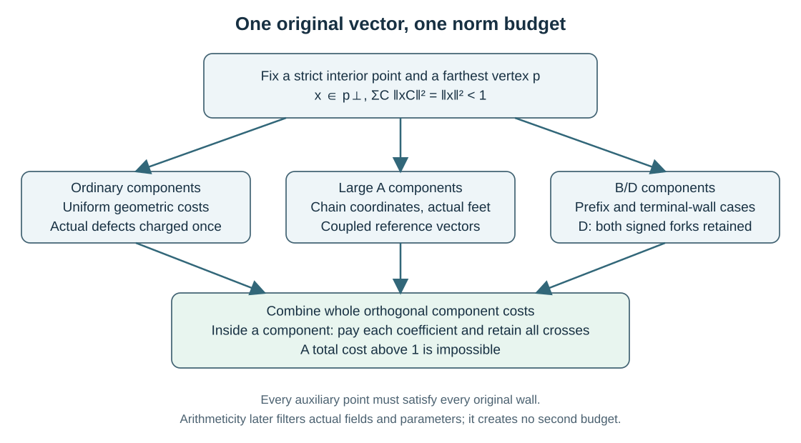

.. _compact-bounds-chapter:

Compact bounds: one vector, geometry and arithmetic
===================================================

The general compact working article proves the repository ceiling
:math:`n\leq17`. Its arithmetic companion proves :math:`n\leq15` by
adding restrictions on the actual ground field and integral cycles.
These are two existing paper families. Their complete working revisions
retain the same geometric foundation and separate the places where the
arguments branch.

The :download:`general compact proof map <../compact17_consolidated_proof_map_20261025.md>`
and :download:`arithmetic proof map <../compact_arithmetic_consolidation_proof_map_20261025.md>`
identify the printed proof of each case. The current :download:`combined dimension article <../../manuscripts/build/arxiv_hyperbolic_coxeter_dimension_bounds_20261028_current_20261030.pdf>`
contains the compact argument in Parts II/V and the arithmetic argument in
Parts III/VI. Its :download:`TeX source <../../arxiv/hyperbolic_coxeter_dimension_bounds/main.tex>`
makes the compact theorem an internal dependency of the arithmetic proof.
The case appendices are part of the proofs. No minimal standalone page
count has been established by separating off the common exposition.

 budget.
   :align: center
   :width: 100%

   The budget is geometric. Arithmeticity supplies additional constraints
   on actual root lines; it is absent from the general compact proof.

.. _compact-original-vector:

The original farthest vertex
----------------------------

Use the Lorentz model of signature :math:`(-,+,\ldots,+)`. Choose one strict
interior point :math:`z` and an actual vertex :math:`p` farthest from it.
Write

.. math::

   z=E(p-x),\qquad E>0,\quad x\in p^\perp,
   \qquad \|x\|^2<1.

The inequality follows from the unit future normalization. Compact acute
simplicity gives a finite spherical diagram at :math:`p`. Its whole
orthogonal components decompose the spatial vector:

.. math::

   \|x\|^2=\sum_C\|x_C\|^2=\sum_C e_C<1.

Disjoint whole components give independent summands in this identity.
Overlapping subdiagrams of one component do not. For example, a long
chain and an endpoint block in that chain cannot each be charged as a
separate component of the norm.

An actual adjacent vertex has the form

.. math::

   q=\cosh L\,p-\sinh L\,u,\qquad \|u\|=1.

Original maximality gives

.. math::

   -\langle z,q\rangle
      =E\bigl(\cosh L-\sinh L\,x\cdot u\bigr)\leq E,

and hence the basic pressure

.. math::

   x\cdot u\geq\frac{\cosh L-1}{\sinh L}
       =\tanh(L/2).

More generally, a future unit point :math:`q=ap-v` that satisfies every
wall of the original polytope gives :math:`x\cdot v\geq a-1`.
This provides pressures from feasible projected points as well as from
actual edge endpoints.

.. _compact-all-walls:

Why the other walls cannot be omitted
~~~~~~~~~~~~~~~~~~~~~~~~~~~~~~~~~~~~~

A formula satisfying the walls used to construct a point does not yet
place it inside the original polytope. The proof checks the selected
products, future orientation and normalization, then every omitted wall.
Positive combinations of actual wall normals are useful because acuteness
makes their products with unselected walls nonpositive term by term.
Those signs do not remove the need to prove the finite or negative square
and the future-sheet condition.

An adjacent vertex may be used locally, but it is not declared farthest.
If a local argument at :math:`q` uses a vector :math:`y`, its comparison
factor must be derived from the same original maximum at :math:`p`.
The local whole-:math:`A_{18}` argument in the general compact proof is an
important instance: it uses the actual neighboring vertex and its reverse
direction, with the stated comparison bound, rather than a new choice of
farthest vertex.

.. _compact-paid-references:

Turning pressures into one norm lower bound
-------------------------------------------

For any reference vector :math:`w`, the completed square gives

.. math::

   \|x\|^2\geq2x\cdot w-\|w\|^2.

A positive reference combines known old-dual pressures. Its individual
coefficients are the available prices for subsequent modifications.
An endpoint graft, isolated foot or head correction can use a coefficient
only if the required debit fits at that particular anchor.

This accounting has two consequences. First, a weak knot must be omitted
before a pressure that has not been proved there is used. Its reference
coefficient becomes zero. Second, several improvements inside one component
must be put into the same modified reference before its norm is evaluated.
Adding two separately optimized gains can spend an anchor twice or discard
an adverse cross term.

Some residual corrections have zero sum on a flat coordinate block. That
can make them orthogonal to the reference, but orthogonality is an identity
to be checked. A general zero-sum vector need not be orthogonal to every
reference. The manuscript retains the full cross whenever the required
orthogonality is unavailable.

.. _compact-component-cover:

Component estimates produce necessary forest covers
---------------------------------------------------

The ordinary component arguments bound :math:`e_C` for whole irreducibles,
uniformly over their permitted spectators. Short opposite walls create
specific exceptions with geometric meanings: the isolated rank-one
alternative :math:`I`, its separately funded :math:`J` alternative, and
the two typed rank-two defects :math:`N_7,O_7`.
An old diagram containing a seven-labelled bond is not by itself one of
those typed defects. Their actual new wall and compatibility conditions
are retained.

The forest algorithm lists rank partitions and spherical irreducibles,
keeps the full spectator forest, and discards an entry only by an available
same-vector inequality. Unbounded ordinary dihedral labels are handled by
uniform statements, rather than truncated to a finite experimental range.
Finiteness of partitions and type choices proves termination. Spherical
classification and the defect-compatibility arguments prove coverage.

For a simple example of the accounting, the printed general estimates
:math:`e(A_{16})>43/50` and :math:`e(T_2)>1/7` exclude their ordinary
rank-eighteen sum, since their disjoint component costs already exceed one.
The same :math:`A_{16}` estimate with just an ordinary rank-one cost does
not give that contradiction. Actual rank and the entire spectator forest
therefore matter. A necessary forest list is not a collection of realized
Coxeter polytopes.

.. _compact-classical-branches:

Where the classical arguments separate
----------------------------------------

The A-chain branch
~~~~~~~~~~~~~~~~~~

The coordinate model for :math:`A_r` uses the zero-sum subspace of
:math:`\mathbb R^{r+1}` and actual unit roots
:math:`(e_i-e_{i+1})/\sqrt2`. Its inverse Gram matrix gives the
dual-coordinate pressures. Central windows, endpoint walls and actual
isolated feet are then combined by coupled references.

The proofs keep both endpoints and their common possible opposite walls.
Their inventories include native finite, parallel and dotted alternatives
with the stated spectator costs. Complete continuous intervals are covered
by proved scalar inequalities; a sample of numerical parameters would not
exclude an interval. Different ranks have different windows and prices,
so a stronger whole-diagram result at one rank is not simply reused at
another.

The common B/D prefix
~~~~~~~~~~~~~~~~~~~~~

Long initial segments of :math:`B_r` and :math:`D_r` share a coordinate
model. A weak-site inventory first determines the possible actual caps.
Concave interpolation through the genuinely strong knots supplies the
reference, and explicit hole losses pay for omitted weak sites.

The short :math:`B` end and the signed :math:`D` fork require separate
terminal classifications. In :math:`D_r`, both genuine fork directions
are retained. Replacing them by one virtual direction would lose precisely
the signed information used in the later norm comparisons.

.. _compact-exact18:

Excluding dimension 18
----------------------

The complete rank-eighteen cover first dispatches proper-component forests
using their actual spectators. Whole :math:`A_{18}` has a two-end argument;
whole :math:`B_{18}` has an exhaustive terminal partition. Its last local
case is treated at an actual neighboring whole-:math:`A_{18}` vertex,
whose comparison factor is derived from the original maximum.

The remaining whole-:math:`D_{18}` analysis has two layers. The foundation
proves head isolation, strong terminal knots, legal reference append and
the finite/parallel head exclusions. It retains the complete fork roles
and both signed assignments. The final dotted-head proof uses four funded
initial-reference cases and the actual head parameter throughout its full
range. It removes the far-next role and completes the remaining isolated,
near and far pair exclusions.

The local :math:`A_{18}` lemma used in those exits is independent of the
original :math:`B_{18}` hypothesis and does not assume its vertex is
farthest. That independence prevents a circular proof of the fork bounds.
The printed proof map names the foundation and final consumers separately.

.. _compact-actual-rank-tail:

The independent tail in dimensions 19 through 29
------------------------------------------------

Excluding dimension 18 alone would not establish the general bound 17.
The article proves the higher exclusions at their actual ranks:

.. list-table:: Higher-dimensional compact argument
   :header-rows: 1
   :widths: 25 75

   * - Dimension range
     - Required proof
   * - 24 through 29
     - Complete rank-specific component covers and their consumers.
   * - 22 and 23
     - Separate covers with the valid local windows and spectator budgets.
   * - 20 and 21
     - Actual-rank proper forests and whole classical cases.
   * - 19
     - Proper-component exclusions followed by whole A19, B19 and D19 arguments.
   * - At least 30
     - Vinberg's published compact ceiling 29.

At rank nineteen the proper cover leaves exactly the three whole classical
forests. Their proofs have different endpoint, short-wall and head/fork
partitions. Each keeps the original vector and checks its own continuous
tails. The final conjunction combines these actual-rank exclusions with
the dimension-eighteen contradiction.

No arbitrary face is assumed to inherit Coxeter angles. There is no
rank-decrement premise and no arithmetic field restriction in this
general compact tail. In particular, the general compact17 proof does
not depend on the arithmetic15 theorem.

.. _arithmetic-extra-structure:

What arithmeticity adds
-----------------------

The arithmetic companion first imports the independent general bound 17.
It then excludes exact dimensions seventeen and sixteen. The extra
structure concerns the actual totally real ground field :math:`K`,
reflection-defined :math:`K`-root lines, integral cycles and positive
definiteness at every nonphysical embedding.

For roots :math:`r_i` on those lines, put

.. math::

   a_{ij}=\frac{2(r_i,r_j)}{(r_i,r_i)}.

The relevant invariant cyclic products are algebraic integers and generate
the actual field. Physically normalized unit roots need not themselves
be :math:`K`-valued, and disconnected components need not have equal raw
norm squareclasses. The argument uses the permitted rescalings and actual
cycles rather than equating those scales.

There are two recurring arithmetic tools:

* If a permitted principal Gram form is defined over :math:`k\subset K`
  and indefinite at the physical place, a nonphysical embedding fixing
  :math:`k` would preserve that indefiniteness. Positive definiteness at
  nonphysical places therefore forces the stated actual-field descent.
* A nonzero algebraic integer has nonzero integral norm. Bounds at every
  conjugate can then exclude a degree or a coefficient range. Checking
  only some nonphysical embeddings would not justify the norm argument.

The arithmetic reflection structure supplies the quadratic-form model;
“first type” is not an additional restriction on these reflection lattices.
The :download:`assumption register <../manuscript_assumptions.md>` records
the literature interfaces. None is assumed in the general compact lane.

.. _arithmetic-four-outputs:

The four computed propositions and their consumers
--------------------------------------------------

The arithmetic article separates an algorithm's complete domain and exact
tests from its recorded output. Its four grouped output premises are:

.. list-table:: Computed premises retained in arithmetic15
   :header-rows: 1
   :widths: 35 32 33

   * - Necessary domain
     - Recorded result
     - Subsequent use
   * - Quadratic A17 endpoint pairs
     - Empty domain after the necessary tests.
     - Separate actual endpoint inclusion excludes the quadratic case.
   * - Two cubic A17 finite-anchor boxes
     - Both boxes have no surviving strip model satisfying all tests.
     - The actual field and finite-anchor reduction puts every remaining cubic case in a box.
   * - Shared quadratic B17/D17 algebraic domain
     - Two surviving parameter pairs.
     - B17 and D17 have different actual geometric inclusions and explicit consumers of both pairs.
   * - Whole-B16 quadratic head/short domain
     - One surviving parameter pair.
     - Its same-original-vector geometric consumer supplies the contradiction.

An algebraic survivor is not an example of a polytope. Conversely, an empty
finite table says nothing about an actual configuration until the geometric
inclusion into that table has been proved.

Quadratic searches use the full maximal order, including its half-integral
basis when the discriminant requires it. Strict physical and conjugate
strips bound the discriminant and every integer coefficient. Cubic boxes
come from isolating intervals and interpolation bounds before enumeration;
negative coefficients are retained. Exact field-square tests verify the
full identity. A rational square norm is necessary for a field square but
is not sufficient. See :ref:`alg-arithmetic-domains` for the termination
and completeness arguments.

The replay scopes also differ. The recorded A17 quadratic, cubic and B16
conjunctions revisit their full trial domains using the same implementation.
The B/D17 conjunction checks survivors and fields/counters with its narrower
recorded scope; the complete rejected-domain coverage comes from the actual
source-bound batches. These are not independent second implementations.

.. _arithmetic-dyadic-finish:

The whole-D16 finish is manual
------------------------------

The final rank-sixteen cover leaves whole :math:`D_{16}`. Its own
geometric and field reductions prove that the actual field is quadratic,
the long head is isolated dotted and both genuine forks are isolated
dotted. This is a different problem from :math:`D_{16}+I` in dimension
seventeen; their budgets and case lists are not interchangeable.

The resulting integral generators satisfy the printed strict strips and
the quarter-product conditions

.. math::

   UF/4,\ UG/4,\ FG/4\in\mathcal O_K,

with raw time squares

.. math::

   T_H=U(U-2),\qquad
   T_F=2F(2F-1),\qquad T_G=2G(2G-1).

Every required pair of time products must be a square in the actual field.
At a prime above two, normalized by :math:`v(\mathfrak p)=1`, write
:math:`e=v(2)`, :math:`r=v(U)`, :math:`k=v(F)` and :math:`l=v(G)`.
Quarter integrality implies

.. math::

   r+k\geq2e,\qquad r+l\geq2e,\qquad k+l\geq2e.

Time-square conditions add parity restrictions. The proof splits into odd
head norm and the inert, ramified or split behavior of two, using the full
quadratic integer order and all relevant primes. No principal-ideal or
unramifiedness assumption is inserted. Each remaining possibility fails
an actual cycle, a full field-square condition or one funded norm bound.
There is no whole-D16 census premise.

The geometric consumer retains two signed fork edges even when their
parameters coincide. Their unit directions are obtained by normalizing
the actual signed vectors; averaging the two pressures is legitimate
because both concern the same original :math:`x`. It does not create a
third, virtual edge or permit a second independent use of the head energy.

.. _arithmetic-golden-boundary:

The published golden-lattice cutoff
-------------------------------------

The whole-B17 and whole-D17 isolated-five reductions use Bugaenko's
published theorem for the literal lattice and form

.. math::

   L=\mathbb Z[\varphi]^{n+1},\qquad
   f=-\varphi t^2+x_1^2+\cdots+x_n^2,
   \qquad n\geq8.

The group generated by all integral hyperplane reflections has a chamber
of infinite volume in every dimension at least eight. It therefore has
no compact chamber. The current arithmetic-15 argument uses this result
only in ambient dimension seventeen; its nearby rank-sixteen diagrams
are wall-deletion diagrams, not a change of ambient dimension.

The original paper's printed page 6 was directly inspected on 26 October
2026 and independently checked against its first-page image. It states
exactly this form, reflection group and dimension range. The earlier
primary-text authentication gap is closed. The
:download:`authentication note <../bugaenko_golden_lattice_cutoff_authentication_20261026.md>`
and :download:`independent primary-source review <../../results/review_bugaenko_golden_cutoff_primary_authentication_20261026.md>`
record the source identity and precise scope. Bugaenko's proof remains a
published external input; it has not been reproved or formalized here.

The passage to every compatible invariant lattice is a separate internal
argument using the actual root configuration. Similarity or commensurability
alone would not supply it. The article prints that bridge rather than
assuming that a statement about one lattice automatically holds for all
lattices in the same ambient form. The printed argument establishes actual
group containment, so the full integral reflection arrangement refines
the hypothetical compact chamber and gives the contradiction. The theorem
does not exclude all quadratic forms over the golden field.

.. _arithmetic-final-implication:

The final implication and its verification boundary
---------------------------------------------------

The proof graph has one direction:

.. math::

   \begin{aligned}
   &\text{general compact }17\\
   &\quad+\text{complete exact-17 arithmetic exclusion}\\
   &\quad+\text{complete exact-16 cover and manual D16 exclusion}\\
   &\qquad\Longrightarrow n\leq15.
   \end{aligned}

The conditioned :math:`A_{11}>.652761` component corollary is used by the
rank-sixteen cover. Its proof is independent of either cover, which avoids
circularity; that independence does not make the corollary an unused
extra result. The detailed closed cases in the appendices are likewise
supporting arguments for the global dispatch. Exploratory improvements
toward stronger ceilings remain outside these articles.

The :download:`editorial completion record <../../results/compact17_arithmetic15_editorial_completion_20261025.json>`
binds mathematical source acceptance, matching PDF builds and sampled
visual reviews. Those are different kinds of evidence. A PDF build does
not verify a geometric inference, and sampled pages do not amount to an
all-page visual audit.

The two :download:`compact17 conditional Lean modules <../../results/compact17_targeted_lean_completion_20261025/manifest.json>`
have actual bounded compilation and separate actual axiom audits for
seven scalar and three composition declarations. The arithmetic composition
and dyadic kernels retain their own recorded scopes. Geometric instances,
complete inventories, actual-field interpretation and computed propositions
remain ordinary parameters. The :download:`formal guide <../../formal/README.md>`
and :download:`logic map <../compact_dimension17_conditional_logic_map_20261024.md>`
make those boundaries visible. No complete geometric Lean formalization or
combined current-manuscript runtime replay is claimed.
