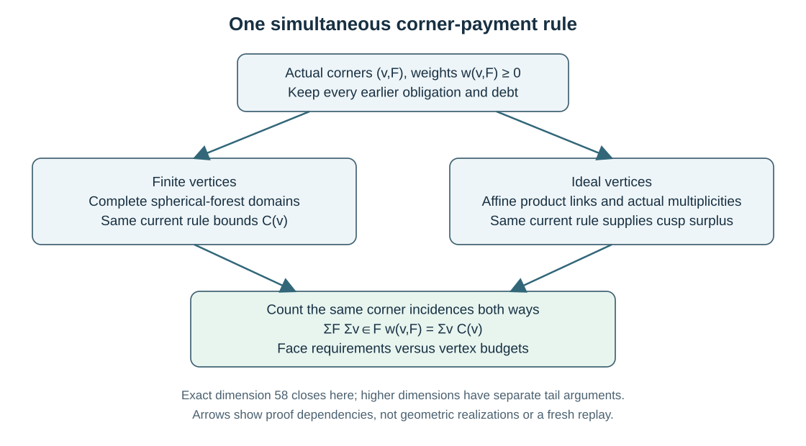

.. _finite-volume-chapter:

Finite volume: one corner rule and two kinds of vertex
======================================================

The general finite-volume argument proves the repository ceiling
:math:`n\leq57` for finite-sided, finite-volume real hyperbolic Coxeter
polytopes. It assumes neither arithmeticity nor compactness. Ideal vertices
may be nonsimple, and no bound on the number of facets is imposed.

Parts I and IV of the :download:`combined dimension article <../../manuscripts/build/arxiv_hyperbolic_coxeter_dimension_bounds_20261028_current_20261030.pdf>`
contain the geometric argument, finite algorithm contracts and reviewed
terminal-tail lemma. Its :download:`TeX source <../../arxiv/hyperbolic_coxeter_dimension_bounds/main.tex>`
includes the compact and arithmetic proofs as well. The
:download:`proof map <../finite_volume57_lemma_map.md>` identifies each
interface and its original source binding.

   The finite and ideal branches use the same corner payments. The
   higher-dimensional tail has its own argument.

.. _fv-local-rule:

What is being paid?
-------------------

An angle is an actual incidence :math:`(v,F)` of a vertex and a
two-dimensional face. Its nonnegative payment is :math:`w(v,F)`, and the
total charge at a vertex is

.. math::

   C(v)=\sum_{F\ni v}w(v,F).

Write :math:`s(F)` for the number of sides of :math:`F` and define

.. math::

   D_5(P)=\sum_F(5-s(F)).

A triangle needs total payment at least two; a quadrilateral needs at least
one. For a face with at least five sides, nonnegativity already gives the
required lower bound :math:`5-s(F)`. Summing the face inequalities gives

.. math::

   D_5(P)\leq\sum_v C(v).

This elementary step explains why the construction uses a *simultaneous*
rule. Two local lemmas may both discover a useful corner, but they cannot
each spend its full weight independently. A replacement, priority or
transfer must be included in the final function before the vertex charge
is maximized. Earlier debits remain present when a later repair is made.

The rule is evaluated on a marked whole vertex diagram. A path visible
inside a larger component need not have the weight of that path considered
as an entire component. The distinction matters for contextual bonuses,
affine completions and the final guarded changes.

.. _fv-incidence-contradiction:

The subtraction at dimension 58
-------------------------------

Let :math:`v_f` and :math:`v_i` count finite and ideal vertices. The two
local branches establish the interfaces

.. math::

   C(v)\leq377\quad\hbox{at a finite vertex},
   \qquad
   \kappa(v)-C(v)\geq36\quad\hbox{at an ideal vertex}.

Here :math:`\kappa(v)` is the curvature expression of the actual ideal
link. The incidence argument gives

.. math::

   D_5(P)\geq377v_f+\sum_{v\text{ ideal}}\kappa(v)+4205.

Combining this with the payment upper bound cancels the finite contribution:

.. math::

   0\geq4205+\sum_{v\text{ ideal}}\bigl(\kappa(v)-C(v)\bigr)
     \geq4205+36v_i>0.

The strict correction comes from two distinct global extrema and is counted
once. It also excludes the all-finite case :math:`v_i=0`. Positivity at
ideal vertices is therefore useful, but the proof does not require an
ideal vertex to exist.

The constants occur in the manuscript's exact propositions and endpoint
certificate. Their geometric interpretation requires the actual
vertex-figure and incidence identities; evaluating the final arithmetic
does not establish those identities.

.. _fv-finite-affine:

Why finite and affine diagrams require different arguments
----------------------------------------------------------

Finite vertices: spherical forests
~~~~~~~~~~~~~~~~~~~~~~~~~~~~~~~~~~

At a finite vertex the incident diagram is a spherical forest of total
rank 58. Its whole irreducible components determine the ordinary corner
costs. Some costs also depend on another component, an actual multiplicity
or a presence condition. Thus the problem is not initially an additive
knapsack problem.

For the integer calculation, charges are multiplied by 64. If
:math:`m_T` is the multiplicity of a type :math:`T`, the cost has the form

.. math::

   C_{64}(m)=\sum_T b(T)m_T
      +\sum_T j(T,T)\binom{m_T}{2}
      +\sum_{T<U}j(T,U)m_Tm_U+\Psi(m).

The same-type interaction refers to two distinct copies. The context
function :math:`\Psi` must retain its whole-component and multiplicity
conditions. Fixing all interacting counts produces an additive residual
problem, whose certificate is explained in :ref:`alg-forest-certificate`.

The alphabet includes the classical finite families and the exceptional
spherical types. Ordinary dihedral parameters are retained through a
proved uniform cost class. This is not a numerical cutoff on dihedral
labels. The resulting forest cover contains every relevant actual finite
vertex; it need not consist only of realizable vertex diagrams.

Ideal vertices: affine factors and fibers
~~~~~~~~~~~~~~~~~~~~~~~~~~~~~~~~~~~~~~~~~

An ideal vertex has a Euclidean link that is a product of Coxeter
simplices. Its affine factors have ranks whose sum is 57. The corners of
the original polytope occur with the product link's actual fiber
multiplicities. One cannot replace a nonsimple cusp by a single simplex,
or count a marked affine factor just once when several original corners
lie above the same reduced description.

For a rank profile :math:`(r_1,\ldots,r_k)`, the polynomial

.. math::

   \prod_{i=1}^k(1+t+\cdots+t^{r_i})

records the product-simplex combinatorics used in the curvature calculation.
The charge envelope is compared with that actual link. Finite-diagram
classification and the written face/fiber correspondence establish why
these are the right quantities; polynomial convolution checks their
values after the profile is given.

.. _fv-positive-concentration:

Reducing the cusp calculation to a finite terminal domain
---------------------------------------------------------

The low-rank reduction moves a pair of simplex ranks
:math:`1\leq a\leq b\leq7` to :math:`(a-1,b+1)`, omitting a zero part.
The envelope cost is unchanged while the ranks remain at most eight.
The corresponding sum of two discrete uniform random variables increases
in convex order. Adding the other, independent factors preserves that
comparison.

The move has an explicit termination measure:

.. math::

   (a-1)^2+(b+1)^2-a^2-b^2=2(b-a+1)>0.

The total squared-rank sum is bounded by :math:`57^2`, so the process
stops with at most one positive part below eight. The terminal domain is
therefore a sorted partition of 57 into parts at least eight, with one
optional exceptional part from one through seven.

The complete recorded calculation has 2,552 profiles. It reconstructs
every polynomial and every rational margin, giving the two separate
assertions

.. math::

   \min m=\frac{87}{10240}>0,
   \qquad \min Vm=36.

The minima need not have the same witness. Their order in the proof is
essential. If the original and terminal quantities satisfy
:math:`V\geq V'` and :math:`m\geq m'>0`, then
:math:`Vm\geq V'm'\geq36`. Multiplication by a decreasing fiber count
would not provide that conclusion before positive normalized terminal
margins had been established.

.. _fv-actual-coverage:

From an actual face to a finite application key
-----------------------------------------------

The local geometry starts from an actual polygon and its original walls.
For a quadrilateral, the two opposite black pairs and the supporting white
walls are retained. Finite adjacent corners, positive affine kernels,
Schur complements and the one-negative-direction constraint control the
possible completions. A necessary local matrix is not automatically a
geometric face: the application still needs its actual-star and
whole-component hypotheses.

The source-bound high-core domain has indices :math:`0,\ldots,2613`.
Its exact six method classes have sizes
1,329, 823, 259, 120, 74 and 9. Each index belongs to exactly one shard

.. math::

   H_s=\{i:0\leq i<2614,\ i\equiv s\pmod {64}\},
   \qquad 0\leq s<64.

The sets are disjoint and their union is the complete registered domain.
This is a partition argument, not an inference from 64 successful filenames.

An application key retains the original high index and physical core,
ordered base nodes and selected marks, target type and order, finite or
affine flag, complete induced map and marked image. The backtracking
domain tests both edges and nonedges of every labelled injection.
Checking only the marked pair, a family name or the number of paid pairs
would discard information needed to apply the local theorem.

.. _fv-provider-logic:

How a provider discharges a current obligation
~~~~~~~~~~~~~~~~~~~~~~~~~~~~~~~~~~~~~~~~~~~~~~

Some maps receive an intrinsic unit under the current literal rule. The
remaining maps need an exact source application. For a matched provider,
the accepted source proof gives exclusion or total payment of the *same
face* under the absence of an adjacent white-interior path of length at
most eight. The independent :math:`S_8` implication supplies a whole-face
payment when such a path exists.

One can see the logical composition by assuming a face is unpaid.
The independent :math:`S_8` theorem then excludes every such short path.
The exhaustive no-short-path provider branch must exclude the completion
or contradict its unpaid charge. A dependency on :math:`S_8` does not
assert that a short path was observed, and it does not restore an
intrinsic corner unit.

The independent order is

.. math::

   S_5\ \longrightarrow\ F_6\ \longrightarrow\ S_6
   \ \longrightarrow\ F_7\ \longrightarrow\ S_7
   \ \longrightarrow\ F_8\ \longrightarrow\ S_8.

Protected, adaptive and large-:math:`D` conclusions do not establish their
own :math:`S_8` prerequisite. The final guard-true :math:`D_{13}` half
remains a conservative nonunit obligation until its separate application
is supplied. One applicable provider suffices; unrelated provider amounts
are not added.

Prefix requests form a separate domain. They retain either a physical
short path, a displayed component exceeding its accepted whole-order cap,
or an exact protected/adaptive application with its original context and
ordered corner. A component ruled out by its cap is excluded, not assigned
an invented payment.

.. _fv-current-reader:

What the current 259-unit result establishes
--------------------------------------------

The :download:`all-64 application inventory <../../results/finite57_longer_tail_all64_actual_application_completion_20261025.json>`
and :download:`actual final reader <../../results/finite57_final_current_rule_conjunction_execution_20261025.json>`
record successful executions at one accepted source/input/premise snapshot.

.. list-table:: Actual current-rule conjunction
   :header-rows: 1
   :widths: 42 58

   * - Part
     - Recorded scope
   * - Final inventory
     - 195 prerequisite, control and index receipts joined with 64 actual selected applications: 259 units.
   * - Full maps
     - 28,028 maps, comprising 15,510 direct units and 12,518 explicit nonunit applications.
   * - Prefixes
     - 83 distinct physical prefix applications.
   * - Longer terminal tails
     - 24 exact applications of the reviewed additional exclusion.

The reader validates source identities, actual ledger/stdout pairs,
application coverage, exact typed joins and preservation of the selected
ordinary premises in the final input. It reuses the recorded native route
indexes. It does not regenerate the original classification or turn
accepted contact, whole-factor, signature and finite-data propositions
into newly proved facts.

This status is separate from the historical catalogue of 136 scripts,
nine Lean roots and one PDF job. The 25 bounded B13/frontier replacement
units passed and were integrated, while 111 other command matches retain
their inherited execution scopes. No combined fresh 146-job runtime PASS
or complete transitive regeneration is claimed. The
:download:`current reproduction guide <../finite_volume57_reproduce.md>`
and :download:`completion record <../../results/finite57_current_rule_release_completion_20261025.json>`
bind the distinctions and preserve earlier failures.

.. _fv-higher-tail:

Why excluding 58 is not the entire dimension argument
-----------------------------------------------------

The proof treats dimensions 59 through 163 using explicit dimension-specific
payment families, finite-forest bounds and cusp comparisons. Their arrays,
maps, costs and profile propositions have precisely stated inherited
finite-data scopes. In particular a guarded change must use the actual
type and mark conditions of its source; a larger numerical relaxation is
not silently substituted for an actual guard.

For :math:`n\geq164`, the argument is uniform in rank. The external
narrow-facet statement supplies a facet whose actual framing hyperplanes
have pairwise distance less than :math:`\operatorname{arccosh}7`.
With outward normals of square two, this gives

.. math::

   -(x,y)<14.

The internal proof constructs the relevant outgoing edges and terminating
walls from the actual cusp link or compact configuration. Two original
endpoint budgets are retained before a first failing factor is selected.
Only then are the residual budgets and complete exceptional/KKT estimates
applied. Residual estimates alone would not supply the initial full-budget
step.

Neither tail argument decrements the dimension of an arbitrary face.
An arbitrary facet is not assumed to remain Coxeter, and no arithmetic
inheritance is used. Together, the excluded dimension 58 and the separate
higher-dimensional tail give the bound 57.

.. _fv-reading-evidence:

Following the argument and its evidence
---------------------------------------

Read the common payment comparison first, then the actual local coverage,
finite forest and ideal-link branches, and finally the higher tail. The
appendices contain the supporting proofs and algorithm definitions; their
position after the main exposition does not make them optional results.

For implementation contracts and safe commands, continue with
:doc:`algorithms`. The :download:`assumption register <../manuscript_assumptions.md>`
and :download:`formal guide <../../formal/README.md>` expose the published,
geometric and finite-data inputs of the selected conditional Lean kernels.
Their actual compilations and separate axiom audits establish their stated
internal deductions, not an end-to-end formalization of this geometry.
