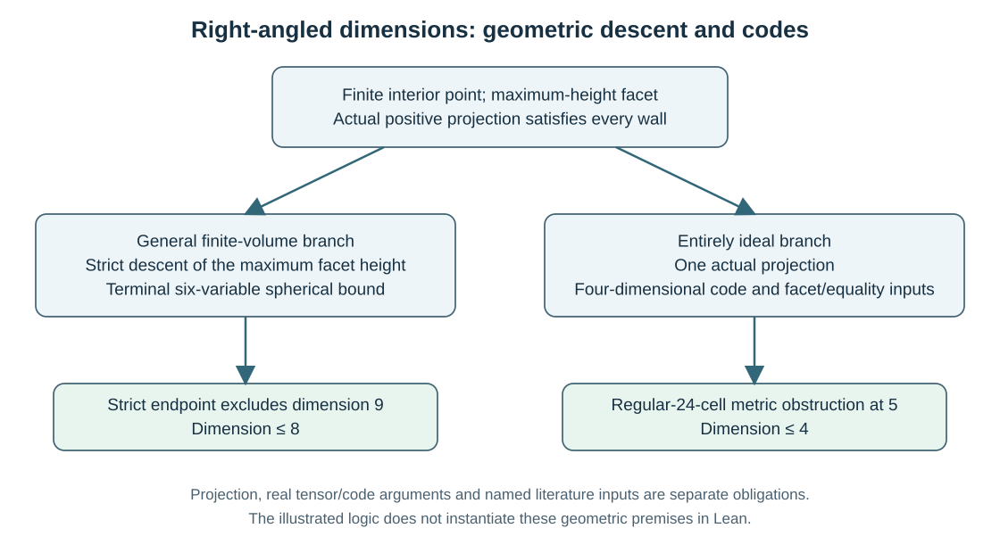

Sharp right-angled dimensions
=============================

The five-page paper proves that a finite-volume right-angled hyperbolic
polytope has dimension at most eight, and at most four if every vertex is
ideal. Both bounds are attained by the published examples identified below.
No arithmetic assumption is used. The two proofs share an actual geometric
projection; their spherical-code and literature inputs then differ.

* :download:`Accepted five-page PDF <../../manuscripts/build/right_angled_sharp_dimension_bounds_publication.pdf>`
  and :download:`complete TeX source <../../manuscripts/right_angled_sharp_dimension_bounds_publication.tex>`.
* :download:`Proof and reproduction map <../right_angled_sharp_dimensions_publication_proof_map_20261021.md>`.
* :download:`Current release assembly <../../results/right_angled_release_packages_current_20261025.json>`
  and :download:`root acceptance <../../results/right_angled_current_release_root_acceptance_20261025.json>`.

The full article is the complete published-facing proof package at its
stated external inputs. No smaller minimum essential-page count has been
established. The 17-page ideal-volume paper has a different purpose; see
:doc:`volume_problems`.

Projecting to an actual facet
--------------------------------

Use the Lorentz form of signature :math:`(-,+,\ldots,+)`. A finite interior
point satisfies :math:`q^2=-1` and is on the future sheet. Every actual wall
has an outward **unit** spacelike normal :math:`m`, and

.. math::

   P=\{x\in\mathbb H^n:\langle x,m\rangle\leq0
        \text{ for every actual wall }m\}.

The acute-chamber input gives :math:`\langle m,m'\rangle\leq0` for distinct
actual walls, including non-neighbors. Set
:math:`t(m)=-\langle q,m\rangle>0`, choose a wall :math:`n` of maximum
height :math:`t=t(n)`, and define

.. math::
   :label: ra-actual-projection

   q'=\frac{q+tn}{\sqrt{1+t^2}}.

There are three checks, each needed for the geometric argument:

.. math::

   (q+tn)^2=-1-t^2,\qquad
   \langle q+tn,n\rangle=0,\qquad
   \langle q,q+tn\rangle=-1-t^2<0.

They give a unit point on the future sheet of the selected wall. Feasibility
against **every other original wall** follows separately:

.. math::

   \langle q',m\rangle
   =\frac{\langle q,m\rangle+t\langle n,m\rangle}
          {\sqrt{1+t^2}}<0\quad(m\ne n).

The first term in the numerator is strict and the second is nonpositive.
Thus the point belongs to the relative interior of the actual facet
:math:`Q=P\cap n^\perp`; a point on the correct supporting plane alone
would not be enough.

An intrinsic facet of :math:`Q` comes from an orthogonal ridge neighbor
:math:`m_i`. Restriction to :math:`n^\perp` preserves its unit norm and gives

.. math::

   0<t_i'=-\langle q',m_i\rangle
      =\frac{t(m_i)}{\sqrt{1+t^2}}
      \leq\frac{t}{\sqrt{1+t^2}}<1.

The maximum-height choice supplies this last bound; the all-wall sign check
supplies actual incidence. They serve different purposes.

Why repeated projections retain the hypotheses
----------------------------------------------

In this right-angled setting, an actual face of dimension at least three
inherits right angles: at a finite relative-interior point of each intrinsic
ridge, the relevant original walls are orthogonal. Its Klein-model vertices
are vertices of the original polytope, so entire ideality is inherited when
present. Triangulation into finite or ideal simplices gives finite volume.
These are the face arguments used here, rather than an assumption about
arbitrary faces of general Coxeter polytopes. The descent never reaches a
two-dimensional face.

Let :math:`A_j` be the maximum unit-normal height after :math:`j` projections,
starting with a finite maximum :math:`A_0`. Monotonicity of
:math:`x/\sqrt{1+x^2}` gives

.. math::

   A_{j+1}\leq\frac{A_j}{\sqrt{1+A_j^2}},\qquad
   A_j\leq\frac{A_0}{\sqrt{1+jA_0^2}}<\frac1{\sqrt j}\quad(j\geq1).

The reciprocal-square recurrence adds at least one at each step. A finite
initial point makes the terminal inequality strict, even when a maximizing
facet is not unique.

   The shared geometric stage uses formula :eq:`ra-actual-projection` in
   an actual inherited face. Subsequent arrows indicate logical proof
   dependencies, not edges of the polytope. The two branches use different
   code and metric inputs; the diagram constructs no polytope from formal
   normal vectors.

From heights to a spherical code
--------------------------------

At the resulting point of a :math:`d`-face, choose that point as time axis.
Write its intrinsic unit normals as

.. math::

   m_i=(t_i,\sqrt{1+t_i^2}\,u_i),\qquad u_i\in S^{d-1}\subset\mathbb R^d.

The nonpositive Lorentz products imply

.. math::

   u_i\cdot u_j\leq
   \frac{t_i t_j}{\sqrt{(1+t_i^2)(1+t_j^2)}}\quad(i\ne j).

The directions are distinct. Two identical directions would instead give
a positive Lorentz product of their unit normals. Consequently the code has
exactly as many members as the actual face has facets.

.. list-table:: The two height thresholds
   :header-rows: 1
   :widths: 24 21 24 31

   * - Starting contradiction
     - Actual face reached
     - Strict code condition
     - Next step
   * - A nine-dimensional polytope
     - Six-dimensional, after three projections
     - :math:`u_i\cdot u_j<1/4` in :math:`S^5`
     - A direct cubic tensor argument gives at most 26 facets.
   * - An entirely ideal five-dimensional polytope
     - Entirely ideal four-dimensional facet, after one projection
     - :math:`u_i\cdot u_j<1/2` in :math:`S^3`
     - Musin gives at most 24; Kolpakov identifies metric equality.

The cubic tensor identity and its strict endpoint
-------------------------------------------------

For unit vectors in :math:`\mathbb R^6`, use

.. math::

   F(x)=(x+\tfrac12)^2(x-\tfrac14)
       =x^3+\tfrac34x^2-\tfrac1{16}.

The positive kernel is displayed explicitly. Let

.. math::

   A(u)=u\otimes u-I/6,\qquad
   S(u)_{abc}=u_a\delta_{bc}+u_b\delta_{ac}+u_c\delta_{ab},\qquad
   T(u)=u^{\otimes3}-S(u)/8.

With :math:`x=u\cdot v`, ordinary Euclidean contractions give

.. math::

   \langle A(u),A(v)\rangle=x^2-\tfrac16,\qquad
   \langle T(u),T(v)\rangle=x^3-\tfrac38x.

For the second identity the cubic-to-:math:`S` cross contractions are
:math:`3x` and :math:`\langle S(u),S(v)\rangle=24x`. Therefore an
:math:`N`-point code satisfies

.. math::

   \sum_{i,j}F(u_i\cdot u_j)
    =\frac{N^2}{16}
      +\frac38\left\|\sum_i u_i\right\|^2
      +\frac34\left\|\sum_i A(u_i)\right\|^2
      +\left\|\sum_i T(u_i)\right\|^2
    \geq\frac{N^2}{16}.

Since :math:`F(1)=27/16` and every off-diagonal value is nonpositive when
:math:`u_i\cdot u_j<1/4`, the same sum is at most :math:`27N/16`.
This first proves :math:`N\leq27`, not yet the required 26.

If :math:`N=27`, equality forces every off-diagonal polynomial value to
vanish. The strict product condition excludes the root :math:`1/4`, leaving
only :math:`-1/2`. Four distinct members would then satisfy

.. math::

   \|u_1+u_2+u_3+u_4\|^2=4+12(-\tfrac12)=-2,

contradicting Euclidean norm positivity. Thus :math:`N\leq26`.
The actual six-face must also have at least 27 facets by the named published
input. This excludes dimension nine. In higher dimensions an actual
nine-face inherits the hypotheses and gives the same contradiction.

The ideal branch needs metric equality
--------------------------------------

One projection from an entirely ideal five-polytope gives an actual
entirely ideal four-dimensional facet with all heights strictly below one.
Musin's four-dimensional kissing-number bound gives at most 24 facets.
Kolpakov's ideal-right-angled four-dimensional facet theorem gives at least
24, with equality only for the regular ideal right-angled 24-cell up to
hyperbolic isometry. Uniqueness of a kissing configuration is not assumed.

In the standard Lorentz model of that cell, the unit normals are

.. math::

   (1,\epsilon e_i+\delta e_j),\qquad
   1\leq i<j\leq4,\quad \epsilon,\delta\in\{\pm1\}.

They come in spatially opposite pairs :math:`(1,r),(1,-r)`. A future unit
point :math:`(a,w)` has :math:`a^2-\|w\|^2=1`, hence :math:`a\geq1`.
The pair's heights are :math:`a-r\cdot w` and :math:`a+r\cdot w`.
If both were below one, their sum would give :math:`a<1`. Even the weak
caps at one force :math:`a=1,w=0`, the center with every height equal to
one. This contradicts the strict projected heights. Higher-dimensional
entirely ideal polytopes are excluded by their actual five-faces.

Published inputs and their exact roles
--------------------------------------

.. list-table:: Literature boundary
   :header-rows: 1
   :widths: 31 39 30

   * - Input
     - Role
     - Source anchor
   * - At least 27 facets for every finite-volume right-angled six-polytope
     - Contradicts the 26-point strict code. Includes all vertex types.
     - `Alexandrov, Section 4 and Section 6 <https://arxiv.org/html/2303.09533v1>`_, attributing the result to Dufour.
   * - At most 24 points in a 60-degree code in :math:`S^3`
     - Cardinality only in the ideal branch.
     - `Musin, Main theorem, printed p. 4 <https://annals.math.princeton.edu/wp-content/uploads/annals-v168-n1-p01.pdf>`_.
   * - Ideal right-angled four-polytopes have at least 24 facets, with metric 24-cell equality
     - Recognizes the actual facet in the ideal branch.
     - `Kolpakov, Theorem 4, printed p. 1945 <https://msp.org/agt/2012/12-4/agt-v12-n4-p03-p.pdf>`_.
   * - Finite-volume right-angled examples in dimension eight
     - Sharpness, not the six-dimensional 27-facet minimum.
     - `Potyagailo--Vinberg, Section 3 and Proposition 3.1 <https://ems.press/content/serial-article-files/43032>`_.
   * - The all-wall acute-chamber condition
     - Makes the projection feasible against non-neighbor walls too.
     - `Vinberg, Section 2.1, printed p. 42 <https://doi.org/10.1070/RM1985v040n01ABEH003527>`_.

The :download:`primary-input authentication review <../../results/review_ra_release_primary_inputs_root_20261024.md>`
records direct inspection of Alexandrov's precise statement. Dufour's
original full text was not obtained; its attribution is not relabelled as
direct review. The :download:`assumption register <../manuscript_assumptions.md>`
and :download:`fresh source audit <../../results/audit_sharp_ra_fresh_20261024.md>`
separate these literature facts from the internal argument.

What was actually checked
-------------------------

The two exact workers have narrower scopes than the universal theorem:

.. list-table:: Exact computations
   :header-rows: 1
   :widths: 28 43 29

   * - Source
     - Actual scope
     - Boundary
   * - :download:`24-cell coordinate checker <../../scripts/check_ideal_right_angled_dimension4_model_20261020.py>`
     - 24 unit normals; 276 Gram pairs; 12 opposite pairs; 24 displayed null vertices, cubical links and actual-facet witnesses.
     - Does not claim exhaustive vertex enumeration or prove a literature theorem.
   * - :download:`Tensor-identity checker <../../scripts/check_right_angled_sharp_dimension_sos_20261020.py>`
     - Rational polynomials in twelve independent variables; 36 rank-two and 216 rank-three contractions, with explicit unit-ideal remainders.
     - A universal algebraic identity check, not spherical-code enumeration.

Their actual outputs are preserved in the
:download:`six-job historical core ledger <../../results/right_angled_sharp_projection_height_core_verification_20261020.json>`.
The current five-page source/PDF has its own
:download:`matching zero-warning build receipt <../../results/sharp_ra_audit_edition_readability_build_20261021.json>`.
The core binds a predecessor TeX source. Reusing its unchanged components
does not turn it into a combined run of the current paper.

.. list-table:: Separately compiled and actually axiom-audited Lean kernels
   :header-rows: 1
   :widths: 30 12 33 25

   * - Kernel
     - Prints
     - Proved internal logic
     - Remaining application inputs
   * - ``RightAngledSharpDimensions``
     - 12
     - Discrete code endpoint, actual-projection-chain composition and dimension implications.
     - Typed actual faces/points, real geometric interfaces and the named published facts.
   * - ``RightAngledCubicScalarKernel``
     - 10
     - Coordinate Gram positivity, cubic sum of squares, count and strict endpoint.
     - Actual coordinate/tensor realization and the two pointwise contraction identities.
   * - ``RightAngledProjectionHeightKernel``
     - 8
     - Coordinate norm/sign identities, maximal-height recurrence, finite descent and radial gap.
     - Actual walls/ridges, positive normalizers, future-sheet and incidence interpretation.
   * - ``RegularIdeal24CellHeightKernel``
     - 5
     - Opposite heights, time bound and center contradiction.
     - The actual regular-cell instance and coordinate hypotheses.

The first three form the catalogue core's 30 audited declarations. The
regular-cell module is a separately recorded five-declaration supplement.
The :download:`current manifest <../../results/right_angled_release_packages_current_20261025.json>`
binds their distinct compile and actual-audit ledgers; the supplement also
has a :download:`publication-completion manifest <../../results/lean_publication_completion_20261021/manifest.json>`.
The :download:`projection logic map <../right_angled_projection_height_logic_20261020.md>`
exposes ordinary theorem parameters that printed foundational axiom lists
do not enumerate. These are conditional kernels, not a complete
formalization of actual hyperbolic geometry or the cited theorems.
