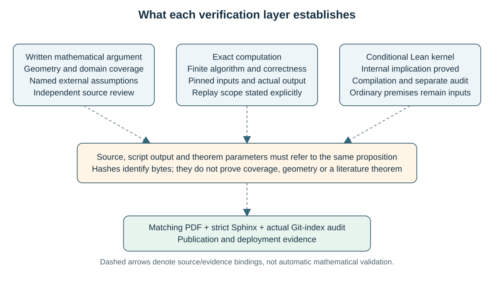

What has actually been verified
===============================

Updated 26 October 2026. The repository contains internally reviewed
written arguments, scoped exact computations, selected conditional Lean
kernels and matching compiled PDFs. Each has its own evidence. No
complete geometric formalization or fresh combined whole-manuscript
runtime PASS is claimed. The new illustrations and documentation add
explanation without a new mathematical replay or a new bound.

   A connection records a stated dependency or a byte binding. Compilation,
   visual inspection and publication checks each answer their own question.

The evidence layers
-------------------

.. list-table:: What each record establishes
   :header-rows: 1
   :widths: 21 39 40

   * - Record
     - Positive evidence
     - Boundary
   * - Written mathematical review
     - A source-bound argument, another author's review and root acceptance at identified inputs.
     - Named external facts and assumed computation outputs retain their stated scopes; acceptance does not regenerate them.
   * - Exact computation
     - The recorded program, input snapshot, finite domain and output passed its actual scoped check.
     - A receipt join, a control test and an application run are different units; none silently regenerates every ancestor input.
   * - Lean compilation
     - The named module was accepted by the pinned compiler under the recorded limits and dependency state.
     - It proves the module's conditional statements, not the geometry or field interpretation supplied as parameters.
   * - Separate actual axiom audit
     - The named declarations were printed in a separate actual Lean invocation at checked source/dependency fingerprints.
     - Foundational axioms do not list ordinary theorem parameters; an old object alone supplies no fresh source-to-object proof.
   * - TeX build
     - Exact source and PDF hashes, page count and warnings for an actual monitored build.
     - A typesetting PASS is not a mathematical check or proof of visual quality on every page.
   * - Visual or diagram review
     - Inspection of named rendered pages, or a stated source-semantic review of diagrams and captions.
     - Source review does not render the PDF; sampled visual review does not inspect every page or another PDF hash.
   * - Site and publication checks
     - Strict Sphinx output, checked documentation inputs and the actual Git-index audit at their recorded versions.
     - They verify delivery and selected input boundaries, not mathematical statements, complete licensing or every possible data flow.

The :doc:`methods` page explains the proof reductions. The
:download:`assumption register <../manuscript_assumptions.md>`, paper maps
on :doc:`papers` and :doc:`formal_logic` identify their external and
computed interfaces. A plan executes no mathematical child. Existing
successful unchanged jobs are not rerun merely to refresh documentation.

Current reading copies and preserved editions
---------------------------------------------

There are six paper families. The six frozen 21 October source/PDF
editions remain unchanged: 48 pages for finite volume57, 36 for compact23,
21 for arithmetic20, five for sharp right-angled8/4, 17 for ideal RA4
volume and structure, and 14 for compact RA4 constraints. Their
:download:`delivery record <../../results/six_paper_final_tex_delivery_20261021.json>`
binds those editions. Later compact17 and arithmetic15 results have their
own reviewed bases and matching PDFs, rather than relabeling the old
23/20 PDFs.

The new illustrated reading copies retain the complete mathematical text
of the reviewed 50/285/216-page bases and add six figures, two per paper.
The :download:`independent source-semantic review <../../results/review_illustrated_manuscripts_diagram_semantics_20261026.md>`
checks all six figure blocks and the two package blocks. Removing the
dated blocks restores each base byte for byte. The source-only proposal
is preserved as a proposal-stage record; subsequent actual build receipts
provide the separate compilation evidence:

.. list-table:: Actual illustrated TeX builds
   :header-rows: 1
   :widths: 27 10 13 50

   * - Reading copy
     - Pages
     - Warnings
     - Matching build record
   * - General finite volume57
     - 50
     - 21 underfull
     - :download:`Attempt 1 PASS <../../results/finite57_illustrated_build_attempt1_20261026.json>`
   * - General compact17
     - 286
     - 9 underfull
     - :download:`Attempt 1 PASS <../../results/compact17_illustrated_build_attempt1_20261026.json>`
   * - Compact arithmetic15
     - 217
     - 8 underfull
     - :download:`Attempt 3 PASS <../../results/arithmetic15_illustrated_build_attempt3_20261026.json>`

These receipts bind source/PDF hashes and page counts. Their warning lists
contain underfull spacing messages, with no overfull boxes, undefined
references or package warnings. They explicitly claim no mathematical
verification. Owned temporary build products were removed.

Arithmetic illustrated attempts
:download:`1 <../../results/arithmetic15_illustrated_attempt1_monitor_stop_20261026.json>`
and :download:`2 <../../results/arithmetic15_illustrated_attempt2_monitor_stop_20261026.json>`
were stopped by the owned-process identity monitor. Their failures remain
preserved and have no TeX or mathematical PASS credit. The later successful
attempt does not rewrite them.

The :download:`25 October editorial completion <../../results/compact17_arithmetic15_editorial_completion_20261025.json>`
records the preceding matching compact bases and sampled visual coverage.
That sampled review belongs to its recorded PDF hashes. Any review of the
illustrated PDFs must identify their own hashes and selected pages; the
new build PASS alone does not transfer old visual coverage. The separate
:download:`six-new-figure visual acceptance <../../results/illustrated_manuscripts_six_new_figures_visual_acceptance_20261026.json>`
now records root's inspection of pages 2/29, 6/20 and 4/38 in the finite,
general compact and arithmetic illustrated PDFs respectively. It binds
the matching new PDF/build hashes and reports legible labels, arrows,
captions and formulas without clipping. This covers all six new figures,
not every page of the three manuscripts; temporary PNGs were removed.
The unchanged right-angled editions retain their existing one/five/four
figures and their five/17/14-page matching PDFs.

The long case appendices discharge proof obligations. The arithmetic15
theorem also uses the general compact17 result. No smaller minimum
self-contained page count has been proved. See :doc:`papers` for the
current downloads and :doc:`volume_problems` for the deliberately narrower
compact RA4 conclusions.

The arithmetic paper's earlier primary-source warning has a separate
:download:`26 October authentication addendum <../bugaenko_golden_lattice_cutoff_authentication_20261026.md>`.
The original statement of Bugaenko's theorem now matches the literal
lattice, full reflection group and dimension range used by the manuscript.
This closes that citation check; the existing internal proofs, computed
output premises and conditional Lean interfaces retain their scopes.

Finite57: the current-rule conjunction and its inherited inputs
------------------------------------------------------------------

The :download:`current-rule completion <../../results/finite57_current_rule_release_completion_20261025.json>`
records actual successful applications at the accepted ordinary and
supplemental premises. The
:download:`all-64 application inventory <../../results/finite57_longer_tail_all64_actual_application_completion_20261025.json>`
contains 28,028 full maps: 15,510 direct units and 12,518 nonunit
obligations, together with 83 prefixes and 24 terminal-tail applications.

The :download:`final 259-unit reader <../../results/finite57_final_current_rule_conjunction_execution_20261025.json>`
joins 195 scoped prerequisite/control/index receipts and the 64 actual
application receipts under one frozen source/input/helper/premise
snapshot. It passed in 6.593 seconds and peaked at 1.35% of physical RAM.
The :download:`registered inputs <../../results/finite57_current_rule_final_inputs_20261025.json>`
identify the exact conjunction. Its units are heterogeneous: a control
or index receipt is not counted as another geometric application.

The eleven ordinary premise records and the
:download:`accepted supplemental premises <../../results/finite57_old_affine_longer_tail_root_acceptance_20261025.json>`
remain explicit. The reader does not prove their geometry, regenerate
the native classification or repeat all inherited numerical work.
The :download:`provider-to-proof register <../../results/finite57_current_provider_proof_home_registry_note_20261025.md>`
and :download:`reproduction guide <../finite_volume57_reproduce.md>`
connect the selected providers to written arguments and preserve failed
inventories and interrupted attempts.

The historical full catalogue has 136 scripts, nine Lean roots and one
PDF job, for 146 selections. All 25 distinct bounded loader-replacement
units actually passed and were integrated; 111 other command matches
retain inherited execution records. The core11 selection is unchanged.
This is not a fresh combined 146-job PASS or complete transitive
regeneration. Later 151/16 execution plans are plans, not executions.

The :download:`50-page working build <../../results/finite57_terminal_tail_working_tex_build_20261025.json>`
and its illustrated successor do not change the
:download:`pinned replay predecessor <../../results/finite57_terminal_tail_working_source_replay_separation_20261025.json>`
used by the existing ordinary-premise/S8 receipts. New human-readable
source and existing replay inputs have separate identities.

Right-angled packages: historical pins and current documentation
-------------------------------------------------------------------

The :download:`25 October package guide <../right_angled_release_packages_20261025.md>`,
:download:`release assembly <../../results/right_angled_release_packages_current_20261025.json>`
and :download:`separate root acceptance <../../results/right_angled_current_release_root_acceptance_20261025.json>`
record the sharp-dimension and ideal-RA4 packages at that date. The
assembly's filename contains ``current``, but it is now a preserved
historical snapshot. It must not be read as a promise that every one of
its 116 path/hash bindings still describes current documentation.

The concise README revision has a
:download:`separate documentation-successor record <../../results/readme_documentation_provenance_successor_20261026.json>`.
The recursive comparison recorded there has 111 matching current bindings
and five historical bindings to the predecessor ``formal/README.md``.
The exact predecessor bytes survive in the named gzip archive. Neither
the old release manifest nor the external-input manifest has been
rewritten to conceal that distinction. Byte preservation and comparison
are documentation provenance, not new scientific execution or primary-source
authentication.

The sharp paper has 30 audited declarations in three selected kernels,
plus five in the separately recorded regular-24-cell supplement. The
ideal paper's selected ``ManuscriptIdeal4`` module has eight printed
declarations in one actual audit ledger. Actual geometry, classifications,
code bounds, equality rigidity, cutting and recognition remain external
facts or ordinary parameters in their stated maps. Historical combined
cores bind predecessor TeX; unchanged components retain their recorded
scope without a new combined current run.

The sharp five-page proof, the ideal second-volume and restricted-chain
theorem, and the compact constraints have different mathematical scopes.
In particular, the compact 14-page paper proves no unrestricted 120-cell
minimum or unique second-volume theorem. Complete scope and input tables
are on :doc:`right_angled` and :doc:`volume_problems`.

Conditional Lean: compilation and actual audit are separate
-----------------------------------------------------------

The :download:`concise formal entry <../../formal/README.md>` points to
:doc:`formal_logic` and the preserved
:download:`detailed formal records <../formal_verification_records_20261025.md>`.
The toolchain is pinned. Each successful module is credited at its actual
source/dependency state, with a separate actual axiom-audit record for its
selected declarations. A missing target requires compilation before its
separate audit.

.. list-table:: Selected successful internal logic
   :header-rows: 1
   :widths: 33 15 52

   * - Scope
     - Declarations
     - Actual evidence and limit
   * - 21 October selected publication gate
     - 9 in two modules
     - :download:`Completion manifest <../../results/lean_publication_completion_20261021/manifest.json>`; two compilations and two separate audits, conditional on their maps.
   * - Dotted-head scalar and compact17 composition
     - 7 plus 3
     - :download:`Targeted completion <../../results/compact17_targeted_lean_completion_20261025/manifest.json>`; geometry, calculus, individual coefficient funding and complete covers remain parameters.
   * - Quadratic/dyadic arithmetic logic
     - 14
     - :download:`Actual verification manifest <../../results/lean_quadratic_dyadic_triple_verification_20261023/manifest.json>`; includes the final implication from :math:`n\leq16` and :math:`n\ne16` to :math:`n\leq15`.
   * - Sharp right-angled selected kernels
     - 30 plus 5 supplement
     - Exact modules, compilation and actual audits are separated in :doc:`formal_logic` and the right-angled maps.
   * - Ideal RA4 selected kernel
     - 8
     - ``ManuscriptIdeal4`` conditional logic; one actual audit prints eight named declarations.

The earlier arithmetic-dimension-sixteen composition has its own three
audited declarations. It supplies the recorded intermediate scope; the
dyadic kernel already includes the targeted final numeric 15 implication.
Neither module proves the actual exact-16 geometric exclusion, all four
computed outputs or the external golden-lattice cutoff. That is why the
logic map and the written proof remain necessary.

An actual audit checks the required matching compiled target/source/import
fingerprints and separately invokes Lean to print the named declarations.
The resulting foundational axiom list does not enumerate ordinary theorem
parameters. It cannot authenticate external literature, completeness of a
classification, geometric realization or the real instance. Even an empty
foundational axiom list would not discharge those obligations.

Failures and deferrals retain their actual statuses. The initial reserved
binder failure and reviewed three-token rename precede the successful
compact scalar retry. Earlier unchanged successful modules are not rebuilt
to refresh the date. Legacy ``IdealRA4Gap``/``CertificateBounds`` dependency
objects have a narrower preserved provenance: no fresh source-to-object
verification is inferred for them from byte restoration.

What a fresh checkout can reproduce
-----------------------------------

The public source tree is not the entire historical working environment.
The bulk manifest binds 936 scientific files in 33 archives, and no bulk
asset has been uploaded. The separate external-input manifest records 37
excluded third-party files and their exact historical bytes. Retrieval,
upstream terms and the availability of identical versions remain separate
requirements. A local restoration archive does not create public access.

The :download:`cleanup receipt <../../results/tex_lean_repro_only_cleanup_20261025.json>`
distinguishes reproducible intermediates from preserved historical Lean
evidence and its required dependency closure. Compressed byte round trips
establish preservation, not fresh compiler acceptance or proof validity.
Thus a reader can inspect public source, stated algorithms and published
receipts without assuming that every historical job is replayable from a
bare checkout. See :doc:`reproducibility` and :doc:`sources` before choosing
a named replay.

Documentation input guard and publication evidence
---------------------------------------------------

The new :download:`Sphinx input guard <../../tools/audit_sphinx_inputs.py>`
is publication-only source. It examines local ``:download:`` targets,
``image``, ``figure``, ``include`` and ``literalinclude`` directives in
site source pages, following included text recursively. It binds those
pages, their local inputs, configuration, templates and all static files.
It compares paths and exact hashes with the 936-file bulk manifest and
the 37-file third-party manifest, including the hashes of the 33 prepared
bulk archives. A renamed identical copy is rejected by its hash as well
as a directly listed file path.

The guard also rejects missing inputs, repository-escaping paths,
symlink inputs or ancestors, listed cache/private path components and
individual inputs above 16 MiB. Text scans are bounded at 4 MiB per
source, with 128 MiB aggregate inputs and at most 4,096 admitted files.
With ``--require-indexed`` it requires each local input to be in the
actual Git index. Its output binds inspected inputs and reports issues;
an issue causes failure. It explicitly launches no mathematical checks.
Its existence or a source review is not an actual audit PASS: the dated
execution receipt must identify the source and inputs actually inspected.

This is a bounded explicit-input guard. It does not analyze arbitrary
Python, JavaScript, Sphinx extensions, or compressed/modified copies of
unknown payloads. A strict Sphinx build and the separate actual Git-index
audit remain required publication steps. No input guard establishes
licensing or authorizes uploading the unuploaded research payload.

Necessary scientific, Lean and TeX work uses the named bounded entry
``scripts/run_proof_batch_20261024.py`` and one shared exclusive proof
lock. The 25 October policy admits work at 2% free disk and 15% available
physical RAM, stops below 1% disk or 6% RAM, and starts cleanup below 2%
disk. Records retain exact byte ratios, totals and the policy-source hash.
Scientific/TeX children use 59 seconds/1 GiB/one thread. Lean uses one
module at 2048 MiB/one thread, followed by its separate audit, under the
outer watchdog's own bounds. Process identity and RSS monitoring stay on.

Publication-only I/O uses ``tools/run_publication_io.py`` with the same
percentage policy and 256 MiB sampled process-group RSS monitoring. That
monitor is not an enforced heap-allocation cap. Root builds Sphinx with
warnings as errors, preserves its receipt, and audits the actual Git index
before every push. Matching PDFs and verification stdout are intentional
evidence. Lean objects/dependencies, TeX intermediates, Python caches,
generated sites and packaging output remain untracked. Source publication,
Pages deployment and any future bulk upload are separate recorded actions.
