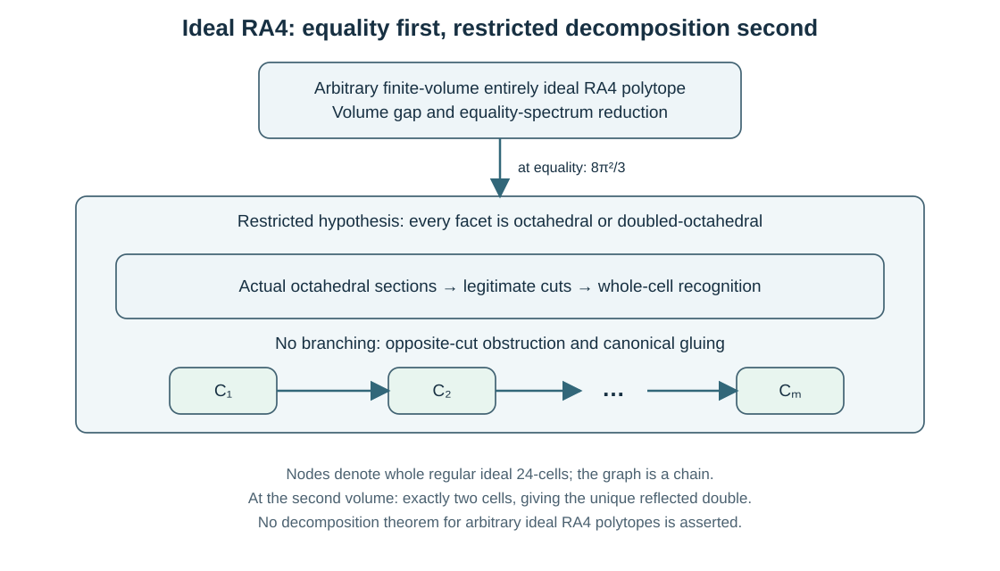

Right-angled four-dimensional volume problems
=============================================

The ideal paper continues the extremal study of right-angled four-polytopes
from the known minimum to the second distinct ideal volume and a restricted
structure theorem. The compact paper in this repository proves capacity,
excess and recognition constraints. The compact minimum has meanwhile been
established in the Guo--Zheng preprint described below; the repository's
compact constraint paper does not supply that proof or a second-volume
classification.

.. list-table:: Current reading editions and their scope
   :header-rows: 1
   :widths: 25 13 36 26

   * - Paper
     - Pages
     - Established statement
     - Excluded interpretation
   * - :download:`Ideal volume and structure <../../manuscripts/build/arxiv_ideal_four_dimensional_volume_and_structure_20261028_current_20261030.pdf>`
     - 18
     - Published 24-cell minimum; internally reviewed next volume and unique reflected double; Oct/D chains.
     - A classification of all ideal four-polytopes as 24-cell chains.
   * - :download:`Compact volume constraints, source <../../manuscripts/compact_ra4_volume_constraints.tex>`
     - Supporting source
     - Facet capacity, neighboring excess, :math:`W=0` recognition and :math:`W\geq17` otherwise.
     - Universal 120-cell minimality, a unique second-volume double or a general decomposition.

These are full article lengths, not proved minimum essential-page counts.
Both use explicitly identified published foundations. Their complete sources
are the :download:`ideal submission TeX <../../arxiv/ideal_four_dimensional_volume_and_structure/main.tex>`
and :download:`compact TeX <../../manuscripts/compact_ra4_volume_constraints.tex>`.
The ideal submission has five inline figures, full historical context and
an outline of the proof. Its
:download:`current source/PDF manifest <../../results/arxiv_submission_current_manifest_20261030.json>`
binds the isolated zero-warning build.

The compact and ideal extremal questions
----------------------------------------

The basic questions ask for the least facet number and the least volume.
In the compact case, `Potyagailo and Vinberg, printed p. 66
<https://ems.press/content/serial-article-files/43032>`_ explicitly asked
whether the least facet number of a right-angled four-polytope is 120.
`Guo and Zheng, Theorem 1.1 and Corollary 1.2
<https://arxiv.org/html/2610.33053v1#S1>`_ establish both compact minima:
the right-angled 120-cell uniquely attains 120 facets and volume
:math:`34\pi^2/3`. Their result is cited as a 2026 preprint.

For entirely ideal polytopes, `Kolpakov, Theorems 3 and 4
<https://msp.org/agt/2012/12-4/agt-v12-n4-p03-s.pdf>`_ had already
established both analogous minima: the regular ideal right-angled 24-cell
uniquely attains 24 facets and volume :math:`4\pi^2/3`. The current paper
continues that ideal-volume question by determining the next distinct
volume :math:`8\pi^2/3` and its unique reflected-double equality case.
The restricted chain theorem explains the cutting geometry used in this
identification. Guo--Zheng's compact result supplies historical context;
the ideal proof uses the external and internal inputs stated below.

Ideal polytopes: the defect measures volume
----------------------------------------------

Write :math:`(v,e,r,f)` for vertices, edges, ridges and facets of an entirely
ideal right-angled four-polytope. Its ideal links are rectangular three-boxes.
Counting incidences gives

.. math::

   e=4v,\qquad r=3v+f,\qquad \sum_R k(R)=12v.

The ridge defect above triangles is

.. math::
   :label: volume-ideal-defect

   W=\sum_R(k(R)-3)=3(v-f)\in3\mathbb Z_{\geq0},\qquad
   \operatorname{Vol}(P)=\frac{4\pi^2}{3}+\frac{\pi^2}{9}W.

For a facet :math:`F`, an ideal right-angled three-polyhedron with
:math:`v_F` vertices, put

.. math::

   d(F)=v_F-6=\sum_{R\subset F}(k(R)-3),\qquad \sum_Fd(F)=2W.

Defect zero gives the regular ideal octahedron :math:`\mathcal O`.
Positive defects are at least two. The published antiprism bound says
that a facet containing a :math:`k`-gon has at least :math:`2k` vertices,
with equality precisely for the :math:`k`-antiprism.

Counting opposite cusp facets without repetition
~~~~~~~~~~~~~~~~~~~~~~~~~~~~~~~~~~~~~~~~~~~~~~~~

Let :math:`m` be the smallest positive facet defect. For a positive facet
:math:`F`, let :math:`q(F)` count nontriangular faces and :math:`s(F)` count
cusps whose intrinsic horospherical rectangle is nonsquare. Each
nontriangular face has a positive neighboring facet. Each nonsquare cusp
has an opposite positive facet in its rectangular ambient box.

The opposite wall is asymptotic to the wall of :math:`F` at exactly that
cusp. It cannot repeat at a second cusp, and cannot also be a ridge
neighbor of :math:`F`. Thus the count is simultaneous and disjoint at the
level of **facets**:

.. math::

   2W\geq d(F)+m\bigl(q(F)+s(F)\bigr).

This is an actual-wall injection, not a count of formal local diagrams.
For a minimum-defect facet the cases are complete:

.. list-table:: The minimum-defect split
   :header-rows: 1
   :widths: 33 40 27

   * - Facet type
     - Input to the simultaneous count
     - Consequence
   * - :math:`k`-antiprism, :math:`k\geq4`
     - :math:`m=2k-6`, :math:`q=2`, all :math:`2k=m+6` cusp rectangles nonsquare.
     - :math:`2W\geq m(m+9)\geq22`.
   * - Defect three
     - The published nine-vertex type is two octahedra joined across a triangle; :math:`q=s=3`.
     - :math:`2W\geq21`.
   * - Defect four, not an antiprism
     - Four quadrilaterals.
     - :math:`2W\geq20`.
   * - Minimum defect at least five, not an antiprism
     - At least three nontriangular faces.
     - :math:`2W\geq4m\geq20`.

The possible defect-two facet is already an antiprism. Hence every noncell
has :math:`W\geq10`; divisibility by three sharpens this to :math:`W\geq12`.
Formula :eq:`volume-ideal-defect` gives the next-volume lower bound
:math:`8\pi^2/3`. This does **not** prove that every possible volume is an
integer multiple of the 24-cell volume.

The equality spectrum is proved before decomposition
~~~~~~~~~~~~~~~~~~~~~~~~~~~~~~~~~~~~~~~~~~~~~~~~~~~~

At :math:`W=12`, the total facet defect is 24. The paper independently
proves that there are exactly eight facets isometric to
:math:`\mathcal D`, the triangular-face double of a regular ideal
octahedron, and every other facet is :math:`\mathcal O`.

The reduction has genuine metric and combinatorial content. A square
antiprism requires enough additional positive triangular neighbors to
exceed the budget. Minimum defect at least five would force four pairwise
adjacent walls and an actual finite vertex. The defect-four Figure 7
matching also exceeds the budget. The minimum is therefore three, leaving
seven or eight positive facets.

In the seven-facet branch the possible excess partitions above seven
copies of three are :math:`3`, :math:`2+1` and :math:`1+1+1`.
The matching excludes defect-four facets. The remaining defect-six facet
is recognized as cuboctahedral by its alternating actual face embedding,
not merely by an abstract graph. Its twelve nonsquare cusps would give
:math:`1+6+12=19` distinct positive facets. Thus there must be eight, each
of defect three. No chain theorem is used to obtain this spectrum.

The restricted Oct/D cutting theorem
------------------------------------

Now impose the independent hypothesis that **every** facet is isometric to
:math:`\mathcal O` or :math:`\mathcal D`. This theorem has no volume
hypothesis. It classifies polytopes that already satisfy this metric
facet-spectrum condition.

From cusp boxes to a closed surface
~~~~~~~~~~~~~~~~~~~~~~~~~~~~~~~~~~~

Every noncubic cusp box has side proportions :math:`2:1:1`. The alternative
:math:`2:2:1` would force an unavailable four-quadrilateral pattern on a
square end face. Four nonsquare doubled facets form the belt; the square
end facets are ordinary octahedra.

Each doubled facet contains its actual internal gluing triangle. Its edges
are interior diagonals of quadrilateral ridges. These triangles glue into
a closed two-manifold after adjoining their ideal vertices: the link at
each such vertex is the four-segment square of the cusp belt. For a
connected component with :math:`n` triangles,

.. math::

   e=3n/2,\qquad v=3n/4,\qquad \chi=v-e+n=n/4.

Disjoint primal and dual spanning trees prove :math:`\chi\leq2` without
assuming spherical topology. The opposite-cusp injection supplies at least
seven distinct doubled facets in that same component. Consequently
:math:`7\leq n\leq8` and :math:`4\mid n`, so :math:`n=8`: twelve edges and
six cusps.

The six-cusp graph is simple. Repeated diagonals would make an asymptotic
opposite pair of original walls contain a second cusp. A simple four-regular
graph on six vertices is the octahedral graph; its eight triangles give a
dual cube of doubled facets.

An actual section, including every outside wall
~~~~~~~~~~~~~~~~~~~~~~~~~~~~~~~~~~~~~~~~~~~~~~~

Index those eight unit wall normals by :math:`s\in\{\pm1\}^3`. Equal
horospherical widths give equal opposite-pair sums on every square of the
cube. The square equations remove the mixed sign characters:

.. math::

   n_s=a+s_1b_1+s_2b_2+s_3b_3,\qquad
   a^2=-\tfrac12,\qquad b_i^2=\tfrac12,

with the four vectors mutually orthogonal. Unit norms and actual
orthogonality of adjacent facet walls give these squares. Their span is
Lorentzian; its intersection with :math:`\mathbb H^4` is a hyperplane
:math:`H`. The six actual cusp rays are :math:`a\pm b_i`.

In orthonormal coordinates the eight inequalities cut out the regular
ideal octahedron

.. math::

   S=\{(t,x)\in\mathbb H^3:|x_1|+|x_2|+|x_3|\leq t\}.

Convexity puts the hull of the six actual cusps inside :math:`P`, while the
eight actual walls give the reverse section containment. Thus
:math:`P\cap H=S`. For an outside facet, a supporting functional cannot
vanish at a finite triangle-interior or diagonal-interior point: those
points already have their exact one or two incident original facets.
The section's interior case follows too. No outside facet can cross it.

The cut has two nonempty finite-volume halves, creates no finite vertex,
and meets the eight cut walls orthogonally. Exactly eight doubled facets
disappear from the total count over both halves. Repetition terminates.
Other belt components lie on one side and give disjoint sections, including
their ideal vertices.

Recognition, opposite cuts and no gluing twist
~~~~~~~~~~~~~~~~~~~~~~~~~~~~~~~~~~~~~~~~~~~~~~

An all-octahedral final piece is recognized directly. Match one whole
regular octahedron to a facet of the model 24-cell. Its triangular faces
and right angles determine adjacent walls; the whole neighboring
octahedra and their inward sides determine placement. Propagation reaches
all model facets. The model halfspaces give one containment and its full
ideal vertex set gives the other. A four-dimensional classification is
not used for this recognition step.

Two cuts incident to a cell must be opposite. Their disjoint closures
leave the :math:`D_4` root products :math:`-1` or :math:`-2`. At :math:`-1`,
the root sum is a common neighbor: the original facet would contain three
regular octahedra with disjoint interiors, contrary to the Oct/D spectrum.
Product :math:`-2` means opposite roots. The cut tree therefore has degree
at most two and is a path. Every octahedral facet symmetry extends to the
regular 24-cell by flag-transitivity, so it supplies no independent gluing
twist.

   The upper boxes describe hypotheses and cutting/recognition steps. In
   the bottom row, the cell blocks denote whole regular 24-cells and
   horizontal arrows denote adjacency across actual octahedral cuts.
   This is a logical and combinatorial diagram, not a metric drawing of
   four-dimensional chambers. The Oct/D hypothesis is required. The path
   classifies existing polytopes; it asserts neither general decomposition
   nor existence for every path length.

If there are :math:`N=8k` doubled facets, there are :math:`k+1` cells.
With :math:`m=k+1`, the theorem gives

.. math::

   \operatorname{Vol}(P)=m\frac{4\pi^2}{3},\qquad
   (v,e,r,f)=(18m+6,\ 72m+24,\ 68m+28,\ 14m+10).

The independently proved equality spectrum has :math:`N=8`, hence two
cells. The placement theorem identifies precisely the reflected double,
with f-vector :math:`(42,168,164,38)` and volume :math:`8\pi^2/3`.

Ideal finite algorithms and verification boundary
-------------------------------------------------

The attaining double is first identified geometrically as the convex union
of a regular cell and its reflection. This justifies the complete vertex
set before reconstructing faces. The fixed checks are then finite and exact:

.. list-table:: Fixed domains, not a four-polytope census
   :header-rows: 1
   :widths: 28 42 30

   * - Domain
     - Completeness and termination
     - Recorded output
   * - The model 24-cell's 10,626 four-wall subsets
     - Solve independent rational systems; retain all feasible points. Every vertex has four independent active walls.
     - 24 ideal vertices.
   * - Facet-vertex intersection closure
     - Every face is an intersection of its containing facets; the finite set of vertex subsets bounds the loop.
     - Double f-vector :math:`(42,168,164,38)`; 12 quadrilateral ridges and eight doubled facets.
   * - 364 cuboctahedral wall triples; 15 labelled six-cusp matchings; six cube equations
     - Rational linear algebra and explicitly finite graph domains.
     - Twelve cuboctahedral cusps with squared aspect ratio two; octahedral graph/cube incidences; cube-equation rank four.
   * - All 276 unordered :math:`D_4` root pairs
     - Exhaust the displayed 24 roots.
     - 96 common-neighbor cases and 1,152 reflected octahedral-vertex incidences.

The :download:`actual historical core <../../results/ideal_ra4_unified_core_verification_final_20261018.json>`
records four exact jobs: the saved double-face checker, equality-model
replay, independent equality-data checker and root checker. The larger
catalogue also offers the historical double-model producer. These finite
facts support the written proof; they do not establish arbitrary-polytope
surface topology, actual cutting, recognition or canonical placement.

``ManuscriptIdeal4`` has eight declarations with actual printed-axiom output,
recorded in its
:download:`separate compile ledger <../../results/lean_execution_ledgers_snapshot_20261021/CoxeterProofs_ManuscriptIdeal4.json>`
and :download:`actual audit ledger <../../results/lean_execution_ledgers_snapshot_20261021/CoxeterProofs_ManuscriptIdeal4_axiom_audit.json>`.
It derives discrete gap/equality and decreasing-cut composition from
explicit interfaces. Actual defect partitions, equality stages, cuts,
recognition, path structure and gluing remain written premises. Legacy
``IdealRA4Gap`` and ``CertificateBounds`` dependency objects were reused;
the release supplies no new source-to-old-object verification or separate
audit for those dependencies.

The preserved seventeen-page source/PDF has a
:download:`17-page zero-warning build receipt <../../results/ideal_ra4_volume_and_structure_publication_build_20261018.json>`
and a :download:`fresh complete source acceptance <../../results/review_ideal_ra4_fresh_audit_root_acceptance_20261024.md>`.
The core's predecessor-TeX binding stays historical. The
:download:`proof map <../ideal_ra4_volume_and_structure_proof_map.md>` and
:download:`assumption register <../manuscript_assumptions.md>` expose the
remaining inputs; a complete clean-checkout replay is not claimed.

The eighteen-page submission adds exposition, citations and a reproduction
section while retaining all five figures and the same theorem scopes. Its
companion suite remains ``ideal_ra4_volume_and_structure``. The script-only
selection has four exact checks on small tracked inputs: saved double faces,
equality-model replay, an independent saved-data check, and the :math:`D_4`
root check. None needs the unuploaded bulk collection. For the exact commands,
companion selections, macOS launcher requirement and the distinction between
catalogue and submission PDF builds, see :ref:`repro-arxiv-editions`.

Compact polytopes: capacity and pentagon excess
--------------------------------------------------

Now every vertex is finite. Compact right-angled polygons have at least
five sides. For a compact right-angled four-polytope define instead

.. math::

   W=\sum_R(k(R)-5)=v-5f,\qquad
   \operatorname{Vol}(P)=\frac{\pi^2}{12}(f+W+16).

These are different normalizations from the ideal triangle defect.
Simplicity gives :math:`e=2v`, :math:`r=v+f` and
:math:`\sum_Rk(R)=6v`. For a facet with :math:`V` vertices and :math:`M`
faces, trivalence and Euler give

.. math::

   M=V/2+2,\qquad d(F)=\frac{V-20}{2}=M-12,\qquad \sum_Fd(F)=2W.

The volume formula follows from the explicitly stated reflection-orbifold
Gauss--Bonnet input and

.. math::

   \chi_{\mathrm{orb}}
     =1-\frac f2+\frac r4-\frac e8+\frac v{16}
     =\frac{v-4f+16}{16}.

The capacity count needs singleton extras
~~~~~~~~~~~~~~~~~~~~~~~~~~~~~~~~~~~~~~~~~~~~

The normal geometry proves that distinct walls have product zero or
strictly below :math:`-1`. A product in :math:`(-1,0)` would give an actual
non-right ridge by an all-wall-checked positive projection; product
:math:`-1` would give a feasible ideal point, contrary to compactness.

Fix a facet :math:`F`. Its :math:`M` neighboring facets and :math:`V`
distinct perpendicular-edge opposite facets give :math:`1+M+V` facets.
In dimension three, a :math:`k`-gonal face needs at least :math:`2k+2`
faces. The proof uses the dual boundary sphere and an ear in its
complementary triangulated disc, not a small-polyhedron census.

Apply that polygon result inside each neighbor :math:`F_i`, and let
:math:`e_i\geq1` count the additional faces supplied by still-unlisted
facets of :math:`P`. An extra facet serves at most two indices. More
strongly, when :math:`e_i=1`, the polygon equality argument says its unique
extra cannot serve any other index. If :math:`s` indices are singletons,
the number of distinct extra facets is therefore at least

.. math::

   s+\frac12\sum_{e_i\geq2}e_i\geq s+(M-s)=M.

This is the step that strengthens a simple incidence estimate. It yields

.. math::

   f\geq1+M+V+M=2V+5.

Neighboring excess and useful local cutoffs
~~~~~~~~~~~~~~~~~~~~~~~~~~~~~~~~~~~~~~~~~~~~~~

If the ridge :math:`F\cap F_i` has :math:`k_i` sides, the three-dimensional
polygon bound gives :math:`d(F_i)\geq2(k_i-5)`. The neighbors are distinct,
so

.. math::

   2W\geq d(F)+\sum_i d(F_i)\geq3d(F),\qquad
   W\geq\left\lceil\frac{3(V-20)}4\right\rceil.

Shared ridge contributions cause no double-counting error: the exact total
of facet defects is already :math:`2W`. Combining the two bounds gives

.. math::

   f+W\geq2V+5+\left\lceil\frac{3(V-20)}4\right\rceil.

The regular 120-cell has volume :math:`34\pi^2/3`. At or below that
comparison volume, :math:`f+W\leq120`, whereas :math:`V=48` would force
:math:`f+W\geq122`. Since :math:`V` is even, every facet has at most 46
vertices. Strictly below its double, :math:`f+W<256`; :math:`V=98` would
force at least 260, leaving the local cutoff 96. The endpoint values 46
and 96 are not claimed to be excluded or realized by this calculation.

Why positive excess starts at 17
~~~~~~~~~~~~~~~~~~~~~~~~~~~~~~~~

When :math:`W=0`, all facets have twelve faces. The explicit
three-dimensional metric input makes them regular right-angled
dodecahedra. Matching and propagating whole facets recognizes the whole
120-cell. It does not propagate from a single dodecahedral facet whose
neighbors could be larger.

For positive facets distinguish two graphs. In :math:`G`, edges are
nonpentagonal ridges with positive integral weights :math:`k-5`; weighted
degrees are :math:`d(F)` and total weight is :math:`W`. In :math:`H`,
include **all** adjacencies between positive facets, including pentagonal
ones. The no-induced-square argument belongs to :math:`H`, not just
:math:`G`.

A degree-two vertex of :math:`G` forces a Löbell facet. Its metric
pentagons give :math:`W\geq20`. The polygon inequality also excludes
degree one; positive weighted degree excludes degree zero. Thus
:math:`0<W\leq16` forces minimum degree at least three. Let :math:`N` be
the number of positive facets and :math:`E` the unweighted edge count. Then

.. math::

   3N\leq2E\leq2W\leq32.

The written graph argument gives :math:`N\geq10`, hence :math:`N=10`.
At most two facets can have defect greater than three. A separate
five-neighbor exclusion uses actual marked hexagon and pentagon lengths
to show that the other facets have at least six positive neighbors.
For example, four regular-pentagon-length edges in a right-angled hexagon
force its two remaining opposite edges to have twice that length. They
cannot match an adjacent regular pentagon.

The complement of :math:`H` consequently has maximum degree four, with
at most two vertices of degree four, and has no induced pair of disjoint
edges. The proved ten-vertex lemma gives an independent set of size five,
contradicting the absence of a five-clique of actual walls. Therefore

.. math::

   W=0\quad\text{or}\quad W\geq17.

The marked polygon geometry is essential. The weaker abstract graph
conditions alone admit :math:`C_5[K_2]`; the paper explicitly avoids
treating those conditions as a sufficient exclusion.

The limits of the compact constraint paper
~~~~~~~~~~~~~~~~~~~~~~~~~~~~~~~~~~~~~~~~~~

The paper does not prove :math:`f+W\geq120`. Its local cutoffs and
positive-excess gap therefore do not supply the compact minimum theorem now
proved in the Guo--Zheng preprint. They also do not prove a universal
second-volume gap, a unique double, or a decomposition into regular 120-cells.
The comparison double is a model used to obtain a threshold, not a
classification of all chambers below it. A compact second-volume
classification remains beyond the results of this constraint paper.

The four existing manuscript diagrams depict the dual ear argument, the
capacity incidence count, positive-neighbor geometry and small-graph proof
cases. They carry no assertion that an arbitrary drawn graph is realized
by a hyperbolic polytope.

Compact evidence and primary-source boundary
--------------------------------------------

The :download:`14-page zero-warning build <../../results/compact_ra4_volume_constraints_W17_build_20261019.json>`
and :download:`four-figure visual record <../../results/compact_ra4_w17_figure_visual_review_20261019.json>`
are typesetting/inspection evidence. The complete written argument has
:download:`root review <../../results/review_compact_ra4_volume_constraints_W17_root_20261019.md>`
and an :download:`independent full review <../../results/review_compact_ra4_volume_constraints_W17_finite57_20261019.md>`.
The :download:`proof/reproduction map <../compact_ra4_volume_constraints_reproduce_20261019.md>`
identifies the universal written geometry. Its catalogue selection does
not use a numerical polytope census or a geometric Lean verification of
the whole capacity/excess proof. Compilation alone does not establish it.

The dated reproduction guide retains historical resource-gate prose.
Any necessary new replay uses the current percentage policy described in
:doc:`verification`; successful unchanged jobs need no status-only rerun.

.. list-table:: External inputs and antecedents
   :header-rows: 1
   :widths: 31 39 30

   * - Input or antecedent
     - Used for
     - Primary source as identified in the manuscripts
   * - Ideal volume/incidence, antiprism bound and specified small ideal three-polyhedra
     - Ideal defect identities, the nine/ten-vertex entries and metric identification.
     - `Kolpakov, Lemmas 1--2, Proposition 5 and Section 4.3 <https://msp.org/agt/2012/12-4/agt-v12-n4-p03-p.pdf>`_. The minimum is his Theorem 3.
   * - Ideal three-polyhedron rigidity
     - Identifies the stated combinatorial facet types at fixed right dihedral angles.
     - `Rivin, A characterization of ideal polyhedra in hyperbolic 3-space <https://doi.org/10.2307/2118652>`_.
   * - Compact facet and volume minima
     - Historical context for the ideal second-volume problem; not an input to the ideal proof.
     - `Guo--Zheng, Theorem 1.1 and Corollary 1.2 <https://arxiv.org/html/2610.33053v1#S1>`_, preprint (2026); the facet question is in `Potyagailo--Vinberg, p. 66 <https://ems.press/content/serial-article-files/43032>`_.
   * - Figure 7 incidence transcription
     - Four quadrilaterals with adjacency two disjoint edges; classification hypotheses remain external.
     - :download:`Original-image authentication and retrieval provenance <../../results/ideal_ra4_figure7_primary_authentication_20261024.md>`; the third-party image is excluded from the release.
   * - Compact twelve-face metric dodecahedron input
     - Zero-excess recognition and the regular-pentagon length arguments.
     - `Alexandrov--Bogachev--Vesnin--Egorov, Section 1.2 <https://doi.org/10.4213/sm9740e>`_.
   * - Marked compact nonobtuse three-dimensional uniqueness
     - Turns the stated Löbell symmetries into metric symmetries.
     - `Roeder--Hubbard--Dunbar, Theorem 1.4 <https://doi.org/10.5802/aif.2279>`_.
   * - Perpendicular-opposite mechanism and orbifold face formula
     - Published antecedent and volume normalization, distinguished from the internal strengthened count.
     - `Kellerhals--Perren, Proposition 3.2 <https://doi.org/10.1016/j.ejc.2011.03.020>`_.
   * - Three-dimensional excess identity
     - An explicitly attributed antecedent, not a novelty claim.
     - `Inoue, Lemma 3.3 <https://doi.org/10.2140/agt.2008.8.1523>`_.

The :download:`primary-literature comparison <../../results/compact_ra4_primary_literature_comparison_20261019.md>`
records the stated antecedents. These pages explain the repository's
arguments and accepted scopes; they make no worldwide priority claim and
do not replace the cited literature proofs.
