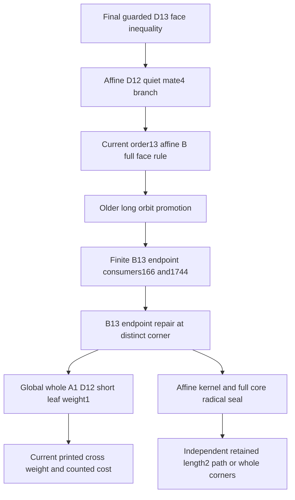

# Finite57: fresh local-routing and whole-component audit

24 October 2026. Reviewer: `/root/audit_sharp_ra`.

**Scoped acceptance:** the common geometric implications in Root's
285-line report are correct at its declared input boundaries. The
high-core/overlap algorithms inspected below have the stated domain
and monotone-witness meaning. The complete final D13 consumer chain
through the order-13 affine-B rule and finite B13 endpoint repair is
noncircular, and its whole-component arguments cover arbitrary
additional supporting whites.

**This is NOT a fresh PASS for the whole finite57 theorem or all
distributed local outputs.** Low/high and disjoint-core terminal
calculations, every current replacement receipt, all triangle-feature
receipts, exceptional tail/KKT data and the complete printed table to
code comparison remain separate audit obligations. No enumeration,
worker import, scientific test, Lean or TeX process ran. The six
primary TeX/PDF pairs and every frozen proof source are unchanged.

This reviewer supplied none of the new deductions in Root's report
before it was written and supplied no edits to the frozen routing
sources in this audit. Older authorship and execution evidence is not
being attributed to this fresh review.

## 1. Exact source boundary and amount read

The reviewed root report is
`results/audit_finite57_geometry_core_and_tail_interfaces_root_20261024.md`,
285 lines, SHA256
`31495cfa00abf3d73846777fa17db76f4f32e46a0901bf0bf77811a0b4b4e0f0`.
I read it ENTIRELY, and independently reconstructed the deductions
discussed in Section 2 below.

In the main TeX, SHA256
`c300db69c58211ffdf69c22970b289325224ad284d9e63a3c28d88821fca82a0`,
I read ENTIRE requested ranges 164–289, 419–623 and 873–1558,
plus the final proof-atlas index. These include the actual-face
foundations, final guarded local theorem, core/union/extension
algorithm contract, triangle comparison, routing order and current
finite/cross/context/affine weight definitions. I did not independently
regenerate the printed numerical tables.

The following complete sources were read:

|Source|Lines|SHA256|
|---|---:|---|
|`scripts/fresh_high_rank_quasilanner_census_20261017.py`|127|`ab08dbff4912545541bba7117ce66848269e527e4f53270dcde138ef27812399`|
|`scripts/fresh_distance8_high_overlap_20261017.py`|277|`ea78f48a58228319c9474d28d3f646709a808702e330a1a300a3814652c64608`|
|`scripts/fresh_b13_endpoint_retention_20261018.py`|196|`5d0a782872fbb8270fea1706d95bfbf072d46c8f8a99cdae9a62330ac9cb9d53`|
|`scripts/fresh_d13_three_rank15_context_transfer_20261018.py`|353|`a95ea679854ba907ead8640964a258c3baeb3e998052a3e2e3ff20f230cce486`|
|`scripts/fresh_order13_affine_b_singleton_transfer_20261017.py`|239|`35749c95282c04909e1861706ff8115cdd45709e1933748ebae231f92a2ae0f5`|
|`scripts/fresh_finite8_d12_b10_coupon_budget_20261017.py`|79|`4e9852e3cf41f184c3f7161aa70a1d2d53bbaa49f6ded42f3c17fb66f7fb2fa2`|
|`results/fresh_b13_endpoint_retention_20261018.md`|71|`fedf5747f39c26e006084a7af623402205d5114841e31a941d29ef5bd23a384d`|
|`results/fresh_d13_three_rank15_context_transfer_20261018.md`|359|`91e93c3f7ff5eb4e64b435eea2892bf20af08711aed131110f40e898a9322014`|
|`results/fresh_affine_d12_leaf_pair_transfer_20261017.md`|185|`dc8a3bfcfafdf3c951cb668e7c758237194fc0a3a83a55bdf638e728a82a0370`|

Additional bounded reads, not whole-file audits, were:

* The actual matrix obstruction, native-to-rational gauge, inertia,
  context and union routines in
  `fresh_selective_distance10_dimension116_20261017_review.py`.
* Lines 1–125 of `fresh_affine_d12_leaf_pair_transfer_20261017.py`,
  including its complete end-profile formulas and determinant identity.
  Its report was read in full; the remaining literal-construction code
  was not read in full in this audit.
* The complete `embeddings`, `labels`, `mapped`, `target` and `mark_pairs`
  definitions reached through `fresh_ideal7_finite_cross_payments`,
  `fresh_finite_d17_long_pair_support` and
  `fresh_finite_d16_d17_long_pair_half_transfer`.
* The local-provenance portion of
  `fresh_ideal5_weighted_dimension71_20261017.md`, including the explicit
  promotion of cases166/1744 and170/2137, and the complete report defining
  the global A1/D12 short-leaf unit.
* Initial domain definitions of the high-disjoint and low-core workers,
  and the current minimal dependency spine in the lemma map. Their
  uninspected terminal calculations are NOT included in this verdict.

Only the files above were inspected, not every recursive manifest
ancestor or all 146 selected jobs. Their hashes are source identities,
not an execution or historical-census replay.

## 2. Critical review of Root's geometry report

The positive-principal-set projection has the correct plus sign. With
the inverse of a positive-definite Z-matrix nonnegative, it gives a
future timelike point, zero on the selected walls and strict on every
unselected original wall. For an affine block the positive kernel gives
a NONZERO future null: strict pairing with an interior point excludes
the represented zero vector. All incident outside roots must be
orthogonal to every kernel term. This proves whole-factor containment
at the actual cusp, including nonsimple cusps.

The indefinite-core radical has the opposite interpretation: its
represented vector is zero because it is orthogonal to a timelike
vector and has zero square. Thus it legitimately constrains EVERY
additional supporting root. The report correctly distinguishes these
two uses of a Gram kernel.

The minimal-core arguments also apply to actual opposite closed sides.
A singular semidefinite completion would give a feasible ideal point
orthogonal to the entire completion, not merely to its affine block;
other PSD components are orthogonal. This contradicts disjoint opposite
sides. A minimal indefinite subset must contain both marks. For order
at least six, adjoining one root to a proper affine block is already
indefinite by its nonzero contact with the positive null. Minimality
therefore makes that the whole core. The finite/affine proper-five-node
classification excludes labels at least five. Parallel/dotted subcores
are excluded separately. This is geometric classification, not an
arithmetic field restriction.

The attached-forest inverse lower bound is valid under its connected
and per-component-contact assumptions. Schur induction gives diagonal
at least (k/(k+1)); summing the contacted components gives at least

\(M/(M+1)\). Inertia of a represented Lorentz core then makes the
full residual forest matrix PSD and gives (M\le1/(r-1)).
This includes indirect tails, rather than bounding first neighbors only.

The corner-fiber multiplication is exactly the product-link edge count.
The varying pair leaves a free vertex in each other simplex factor,
giving (V/(r_i+1)). Whole-factor containment must precede this count;
the report observes that order. The two-extrema correction is counted
once: at figure dimension57,

\[
G_{\Delta}=812,\quad(5G_{\Delta}-57\cdot58)/2=377,
\quad1+3+\cdots+57=841,
\]

so the two extrema contribute (5\cdot841=4205). The extrema may be
ideal; no all-finite or all-ideal branch is lost.

For report Sections 5–7 I checked the implications at the explicitly
stated framing, support/KKT and packing interfaces, not all numerical
input rows. The cusp-edge omissions identify actual edges; an old
omitted wall strict along an edge cannot reappear at its other endpoint,
since the Klein functional would then vanish along the full segment.
At a new cusp the selected additional wall is a ridge neighbor by the
positive-principal-set projection. The rank-one factor exception needs
another factor, as the report explicitly states. A zero cusp height
would annihilate every factor and force a square-two vector into the
null perpendicular of the full cusp span, which is impossible.

The scale cancellation's lower bound uses
\(q+q^{-1}\le2\max(q,q^{-1})\). At the supplied target/loss bounds it
indeed gives (M(N-37)/9) and (M(N-43)/9). With (N=163+t), the
two stated ranges give (14+t/9) and (14+7t/60), including equality
at t zero against strict framing14. The original two endpoint budgets
are retained. The exceptional and small-A support/packing inequalities
themselves remain computational premises, as the report says.

For a compact selected facet, ambient finite simplicity suffices; the
facet is not assumed Coxeter. Actual two-faces and ambient roots give
the short routes. Two cores with at most eight whites each give a
cross route with at most seventeen edges. Classical finite diagrams
have at most their rank many pairs at a fixed distance, yielding the
stated overestimate17n. The report's two positive polynomial differences
therefore have the indicated conditional comparison role. I do not
extend this to every separate dimension59–163 rule.

I accept the report at precisely these boundaries. This does not adopt
its uncomputed input propositions as newly proved facts.

## 3. Finite cross alphabet and all high-core overlaps

Root's added white–white alphabet explanation is sound. The full white
diagram is spherical. A new bond in a component of rank at least three
has finite label at most five. The only unbounded finite-label exception
is a rank-two dihedral component. In the residual union that would join
two formerly isolated whites, each adjacent to a black in its own
connected opposite core. Those two blacks are adjacent sides of the
quadrilateral, so the new bond creates a length-three marked path.
That branch is already paid. A cross involving a black similarly gives
an earlier shorter route. No number field is required.

The inspected high-core generator covers all 24 affine sources and
every nonzero label2/3/4 attachment. Every proper principal subdiagram
lies in a one-root deletion, so the deletion classification suffices.
Graph identifications are checked as labelled isomorphisms. Its order
counts and comparison with Chein are output checks, not a filter that
could discard an unexpected graph by count alone. The 384 unordered
finite-deletion pairs used in overlap processing represent the 768
ordered markings modulo reversal; every cross pair of black sets is
subsequently checked, so that reversal does not omit a corner.

For high overlaps, every actual intersection is an injective partial
matching of white vertices, preserving edges AND nonedges. The
distance-sum threshold nine follows from exclusion of marked paths
of length at most eight. The actual loops choose all subsets on each
side and all bijections between them. Each eligible matched white
has distance at least two because the other distance is at most seven;
the size bound therefore does not discard an eligible matching.
The empty matching is the separately named disjoint domain, not a
silently dropped overlap case.

The inverse prepruning has the right strict threshold: if a root at a
matched node would acquire a new contact in an edge diagram, inverse
diagonal at least two is already incompatible with strict edge PD.
No later bond can repair that necessary condition. The remaining
edge pruning constructs an explicit NONNEGATIVE vector of nonpositive
square. Positive diagonal gauges are recorded. If a native rational
gauge fails, its all-unit comparison only decreases magnitudes, and
the witness remains valid for all larger physical native magnitudes.

In the extra-cross loop every missing edge between exclusive portions
is tested at minimum magnitude one. If it gives a short path, increasing
its label retains that path. Otherwise `obstruction` lifts the first
nonpositive Z-matrix pivot to a nonnegative witness. Adding further
nonpositive bonds or increasing their magnitudes can only decrease its
square. Hence these witnesses cover arbitrary multi-bond additions;
there is no invalid monotonicity argument for negative INDEX alone.
This is stronger than testing just a finite angle sample.

The six extension-certificate constructors in the overlap source
distinguish radical, residual, relevant-component, isolated-component,
protected-leaf and adaptive cases. Their code explicitly tests the
numerical predicates recorded with each returned certificate. I did not rederive every
one of the 2,614 numerical certificate rows, all relevant-component
joint-tail bounds, or the independent adaptive-nine input. Those remain
explicit computed/local inputs, not newly checked universal outputs.

## 4. One difficult current consumer chain, with its DAG

The chosen subdomain is the final guarded D13 decrease and its genuine
order-13 affine-B/finite-B13 consumers. Its directed dependencies are:

Arrows mean proof dependence, not a sequence of additive debits. The
global unit U predates both final deletions. The older promotion really
used B13 endpoint units in166/1744, so checking only the later216 saved
literal stars would have missed a genuine consumer. The repair is
present and uses a different actual corner, rather than calling the
decreased unit a full payment.

In both15-root stars the actual order13 affine component has a positive
kernel. Any additional supporting white is orthogonal to that entire
component. The full indefinite core radical has opposite nonzero
coefficients at the two omitted blacks. The same additional white must
contact both omitted blacks or neither. Both contacts give a current
length-two path, independently paid. Otherwise it is orthogonal to the
FULL core. Indirect extensions would have a first contacting root and
are excluded by the same argument. The alternate finite components
are therefore whole at arbitrary additional white rank and label.

The current paying corners are:

|Case|Deleted B13 endpoint corner|Distinct retained corner|Actual role|
|---|---|---|---|
|166|(3,9)|(4,7)|Whole A1 and short leaf of whole D12|
|1744|(3,13)|(1,14)|Short leaf of whole D12 and whole A1|

The canonical finite-B13 endpoint is (0,12). Both alternate D12
short leaves map to10 or11, and the CURRENT printed cross table pays
exactly one there. No later contextual row reduces that role. The
older global coupon definition is intrinsic to every such whole
A1/D12 pair, not restricted to170/2137 where it was first needed.
Its older8n budget is provenance, not an extra allowance added to
the final377. The final forest cost already includes the unit.

The mathematical map algorithms are complete for these bounded target
problems: normalized native labels use
\(4g_{ij}^2/(g_{ii}g_{jj})\) with the negative sign checked, so positive
gauges do not change the type. At each backtracking step every unused
target vertex consistent with all previous edges and nonedges is
tried. Degree pruning is necessary only. Deleting the last assignment
proves completeness, and finite target order proves termination.
All component bounds at least13 are included, not only bound exactly13.

This establishes noncircularity of the concrete repair. The old
affine-B long-orbit theorem is used with its repair; the final D13
coupon and decreased D13 half are not premises of R or U.

## 5. Final D13 guard, arbitrary whites and simultaneous corners

The33 selected contexts split into four geometric types. The argument
does not presume that the small displayed block is whole:

* In five proper A12 completions the missing D13 fork leaf must be a
  NEW root, since all other old corner components are orthogonal to
  A12. Its necessary unit contact has projection square6,12,30 or102,
  exceeding two. Extra same-end contacts cannot lower the positive-end
  inverse form; opposite-end contacts already give a short escape.
* In four radical contexts, whole D13 forbids new contacts on its
  thirteen nodes. Every remaining allowed coefficient in the zero
  relation is nonzero. A nonempty contact must meet both signs, giving
  a retained path of length at most eight. Otherwise the entire core,
  including its small unmarked block, is sealed.
* In twelve contexts a small block has no permitted first new contact
  with projection at most two. That block is whole, including against
  arbitrary indirect tails.
* In twelve attached-forest contexts the only remaining old contact
  within K is p, with ((s,r)=(1,4/3),(2,3/2),(3,2)). Native gaps and
  positive-end inverse forms force a single unit contact per new root.
  A simultaneous opposite-end contact has residual Cauchy upper
  (-4/3+2/3=-2/3), forcing the recorded short route. If K grows and
  no escape occurs, EVERY new root in its whole component contacts
  the core only at p or is orthogonal to it. The forest bound then
  gives added rank at most3,2,1. The whole component has rank at most4.

All are incompatible with a finite rank58 corner consisting of whole
D13 and three whole rank15 witnesses. Presence is the Boolean guard
on three distinct components, not a count of subsets of witnesses.

For the genuine unselected affine-D12 consumer, the complete four
end-profile formulas retain the unbounded native opposite products.
The spectator correction is nonnegative. A nonextreme end forces
costs8+4 and zero correction. Disjoint supports then force x=y=0.
Its isolated4 branch uses a distinct A1/D12 unit; mate4 uses the DAG
above; center3 uses two DISTINCT currently guarded D13 halves.
The rank15 witnesses are orthogonal to the whole star in this case,
so both guards are justified. These are terminal face inequalities,
not recursive calls to a previously decreased full unit.

For both extreme ends the heights are proved1/2 before using
\((x-y)^TG_Z^{-1}(x-y)=1\). The old arbitrary two-nonempty-support
classification is an inherited input, not a new census here. In the
changed one-sided branch, the quiet guard forces Z to be exactly
three whole A15/D15 components. Strict edge positivity gives only
the four simple A15 positions and its two doubled endpoint profiles,
or a simple long-end D15 contact. Larger labels and multiple same-end
contacts are excluded by the exact inverse bounds, not a label cutoff.
Every nonzero difference energy is at least15/16, so two active
components exceed one; A15 has no energy-one profile. Exactly one
D15 is active by one black root. The other TWO whole components are
orthogonal to the complete star and remain whole at the new corner.

The resulting marked corner is either A12 endpoint/D16 long end or
D28(0,12), depending on selected-leaf versus mate attachment. Each
new guarded half is at a corner DISTINCT from the quiet D13 half.
Thus the face total is one. Full-rank target matching and the explicit
30-root models check exactly the claimed roles; they do not establish
coverage of arbitrary other routing families by themselves.

The positive guards force only two finite forest families. Their
costs are (170+200+1/2=370.5) and

\(66+108.5+200+1=375.5\), below377. Rank capacity leaves no additional
context witness. The two A12 endpoints give total added vertex charge
one, although a face uses just its one marked endpoint. Outside these
families the final rule only decreases the prior cost. The eight old
B13/D13 plus three-rank15 FORMAL forest obstructions fall from378 to377.
They are necessary cost types, not realized chamber examples.

## 6. What the current source checks do not certify

The inspected source `universal_roles` routines contain descriptive
strings summarizing older whole-family proofs. Those strings do not
execute the older universal arguments. The literal216, later564,
D14-variant24 and positive-D12-output332 checks genuinely compare
their declared stored domains, but cannot by themselves establish an
exhaustive universal output inventory. The manuscript correctly says
those remaining routes inherit their mathematical proofs.

Accordingly this audit accepts the concrete chain and its arbitrary
support extension arguments, while leaving these global obligations
OPEN for the new full audit:

1. Complete current-output/dependency traversal for all other cycle,
   affine-tree, BC and finite6/7/8 replacement theorems, with their
   whole-component premises.
2. Low/high and disjoint high-core terminal calculations, including
   their multi-position and unbounded-three-root clauses.
3. All numerical extension rows and the adaptive-nine interface,
   rather than only validity of the generator and predicate forms.
4. Complete triangle retained-feature comparison against every
   current finite and affine table entry.
5. The simultaneous table-to-code binding, all finite-forest maximum
   inputs and all dimension59–163 rules. Exceptional tail KKT and
   packing outcomes remain named computed inputs.

These are neither failures nor new PASS records. They are the precise
uninspected portions of the requested full proof audit. Successful old
modules or jobs should not be rerun merely to change a date; a missing
source-level review is not repaired by another matching source hash.

For consolidation, preserve the existing final57 theorem and this
ordered proof-dependency structure. Explain the white rank-two
exception and the promotion/repair DAG explicitly. Later dimension57
research toward56 is not part of the theorem57 proof and should stay
outside its TeX. Root acceptance of this scoped review is separate;
no global dimension or verification status is changed here.
